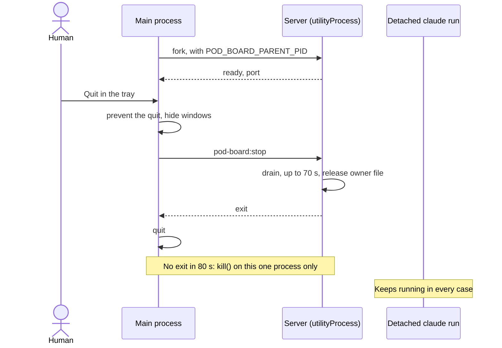

# Desktop shell

## What it is

`packages/desktop` is the Electron main process. It runs the production server bundle in a `utilityProcess`, opens the board in a plain window, keeps a tray icon, and owns the quit. Start it with `pnpm build`, then `pnpm desktop`. Toasts are in [toasts.md](toasts.md). The installer, updates, and the first release are in [installer-and-updates.md](installer-and-updates.md).

## How it works

- **Layout.** Only `main.ts` and `*-main.ts` import `electron` or `electron-updater`. All logic sits in plain modules with fakes, and `no-electron.test.ts` holds this rule.
- **Start.** Name, `APP_ID`, data folder, single-instance lock. A second launch exits here and shows the first window. On `ready`: window and tray, notifier, updater, server.
- **Folders.** The shell data folder holds Chromium's data, the lock, and `window-state.json`. The server's config folder stays the server's own, so a shell and `pnpm dev` share it.
- **Port and token.** The shell sets no port and never holds the token. It reads the port from the server's ready message, and the page gets the token from the server.
- **Server host.** One restart after a failure. A failure is an exit outside a stop, a `fork` that throws, or no ready in 60 s. A second failure shows a native error box and quits. 60 s of ready earns the restart back. A new port fires `onReady` again, and the window and notifier move.
- **Window.** The normal Windows frame, no app menu, no preload, the page isolated. Close hides it. Off-origin `http` and `https` links open in the system browser, and anything else opens nothing. A `--hidden` start shows only the tray.
- **Tray.** Open, Start at login, Quit. The dot comes from `bus.onAttention`. The app writes the login item only on the toggle, so it stays off by default.

**Example, measured on this machine with `pnpm test:electron`.** A resumed `fake-claude` runs behind a `claude.cmd`.

- A normal quit: the main process and the server end, the owner file goes, and the fake lives.
- `taskkill /F` on the main process: the server dies with it before its parent watch runs, and the owner file stays for the next start. The fake lives.
- `taskkill /F` on the server: a new one is ready within seconds. A second kill within 60 s ends in `failed`, with no third start. The fake lives.

**Logic lives in:** `packages/desktop/src/server-host.ts`, `quit-flow.ts`, `window-rules.ts`, and `shell-main.ts`.

## Why it's this way

- **Quit never kills a resumed run.** The research suggested a process-tree kill or a Job Object. Both would stop the detached `claude` runs that the board starts on purpose. Trade-off: a stuck server waits up to 80 s before its kill. See the [plan](../plans/windows-app.md#key-decisions).
- **A stop message, not a signal.** A kill on Windows is abrupt. The parent watch covers a shutdown or a crash, where Electron's quit events don't fire.
- **`utilityProcess`, not the main process.** A server crash doesn't take the window down. Trade-off: `process.execPath` there is Electron's exe, so `claude-runner.ts` never uses it as a Node fallback.
- **Electron, not Tauri.** [The human's choice](../decisions.md#2026-11-02--ship-as-an-electron-app-for-friends-first-under-mit): Electron includes Node, and Tauri adds Rust and a separately built server. Trade-off: an installer of about 122 MB.
- **Close hides to the tray.** Runs and auto-continue need the server alive. Trade-off: Quit is only in the tray menu.
- **A silent start's replacement starts at once.** A `kill` with no exit event must not hang the app.

## Watch out

- **First release: the human's hand-off** moved to [installer-and-updates.md](installer-and-updates.md#first-release-the-humans-hand-off).
- Keep `STOP_KILL_MS` (80 s) above the server's `DRAIN_CAP_MS` (70 s). A test holds this.
- Never add a tree kill, `taskkill /T`, or a Job Object.
- Keep `SystemRoot` in the server's env: without it, `listen` fails in a `utilityProcess`.
- An npm-installed `claude` needs a Node beside it or on the merged `Path`, or the start fails with `node not found`.
- Never import `electron` from a plain module, a test, or a build script, not even `import type`. Under Node, loading the package downloads the binary, and CI has none. The tests' `real-*.test.ts` bodies stay inside `describe.runIf`.
- Electron 45.2.1 has no install script, so `allowBuilds` needs no entry, and `ELECTRON_SKIP_BINARY_DOWNLOAD` has no effect on it.
- `win.maximize()` also shows a hidden window, so a maximized state applies at `ready-to-show`. Call `win.restore()` only on a minimized window.
- A same-port restart must `reload`, because a `loadURL` that repeats a URL with a hash can stay in the same document.
- `session-end` is a window's event. With no window, a session end relies on the parent watch alone.
- A login start while the app runs arrives as a second launch and shows the window.
- Not checked by any agent: the tray menu's look, real clicks on the icon, the native error box, a real `session-end`, and the 80 s kill on a real process.

## History

- 2026-11-03 · desktop-shell D1: the package, the server host, the quit, and the real exit proof.
- 2026-11-03 · desktop-shell T1: the window, the tray, close to tray, the link rule, the window state, and Start at login.
- 2026-11-03 · installer-and-updates P1: the per-user installer, the app icon, the licence notices, and the install proof.
- 2026-11-03 · installer-and-updates U1: auto-update, the test feed, the local two-version proof, and the first release hand-off.
- 2026-11-03 · windows-app · final PR #83, verdict fix at round 2; the installer and updates moved to their own file · [report](../reports/windows-app.html)
