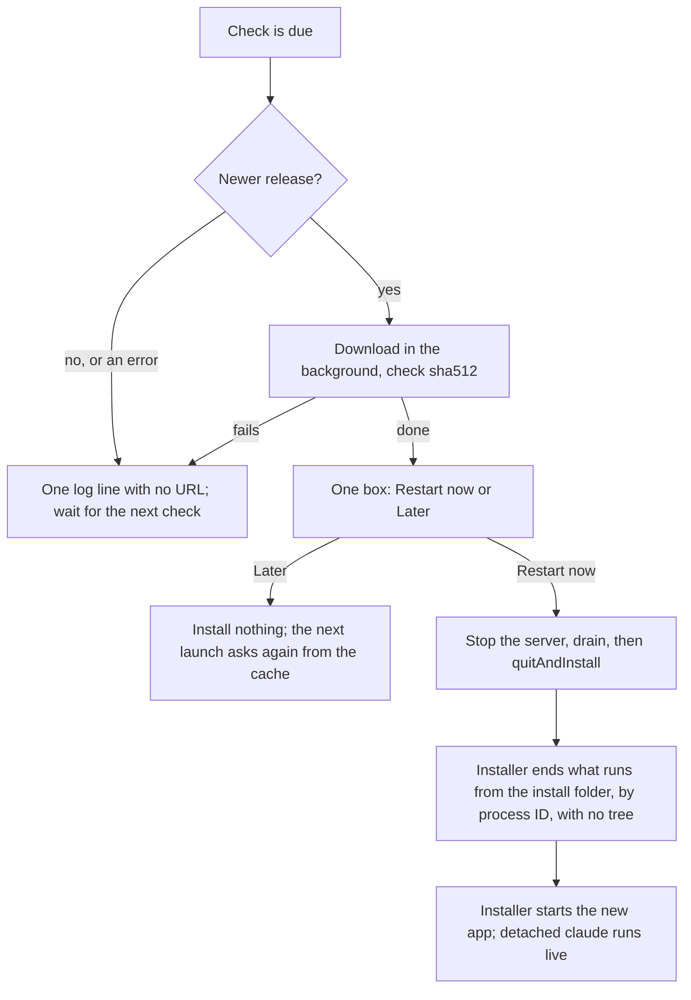

# Installer and updates

## What it is

`pnpm package` builds a per-user Windows installer. A pushed version tag runs a workflow that checks the installer and publishes a GitHub Release. An installed app finds a new release, downloads it, and asks before it restarts. No agent publishes anything. Friends read [docs/install.md](../../docs/install.md).

## How it works

- **Package.** One-click NSIS, no admin rights, a Start-menu entry and an Installed apps entry named `OpenAFlow`, no desktop shortcut. The installer is `openaflow-setup-<version>.exe`, the exe `OpenAFlow.exe`, the app ID `com.alvionlabs.openaflow`, and the install folder `%LOCALAPPDATA%\Programs\openaflow`. The update feed is the GitHub releases of `alvionlabs/openaflow`. `resources/app.asar` holds `dist/main.cjs`, `assets/`, and `package.json`. `resources/server` holds the bundle. `THIRD-PARTY-NOTICES.txt` comes from each bundle's esbuild metafile. A package with no licence file and no override stops the step.
- **After the install.** A normal install opens the app (`runAfterFinish`). A silent install stays closed, so a proof never starts the app with no temp env. The update path is silent with `--force-run`, which starts its one new copy, as it always did. The template rule is `${ifNot} ${Silent} ${orIf} ${isForceRun}` in `installSection.nsh`, and `build-config.test.ts` fails if a new electron-builder changes it.
- **Release.** `release.yml` runs only on a tag `v<major>.<minor>.<patch>` that equals `version` in `packages/desktop/package.json`. Job `build` has a read token: it runs `pnpm verify`, `pnpm package`, and `pnpm release:check`. Job `publish` needs `build`, has the write token, and runs no repo code.
- **Check.** `pnpm release:check` checks the size, `latest.yml`, and the blockmap, then installs, starts, and uninstalls the app. `pnpm test:install` runs the longer proofs. Each ends with `state diff: []`.
- **Update.** Only in a packaged app. First check 30 s after the app starts, then every 6 h. It doesn't wait for the server. After Restart now, the app quits if it still runs 2 minutes after the call to the installer (`INSTALL_LIMIT_MS`). `autoDownload` on. `autoInstallOnAppQuit` and `allowDowngrade` off.
- **Last chance.** When the server fails for good, the app checks at once after the error box. The box says so only when a check runs: not in an unpackaged app or a build with no feed. The check asks again for a version that got Later earlier in this run. A failed check still asks for the newest version that downloaded in this run. No update, a failed check with no download, or Later: it quits. Restart now: it installs. The check and the download have 10 minutes (`LAST_CHANCE_MS`). An open box has no limit, so the app never quits while the user chooses. The tray stays, so Quit works the whole time.
- **Second launch during the last chance.** A second launch or the tray's Open ends the wait. The app quits and starts a fresh copy (`app.relaunch`), which tries the server again and shows the window, also after a login start. While a box is open or a Restart now runs, it does nothing: the box is on the screen, and the installer starts the new copy.

**Example.** A proof installs 0.1.0 and serves 0.1.1 from `http://127.0.0.1:3111/`. The app finds it and logs the ask. On `restart`, it stops the server and quits. About 25 s after the feed's answer, the same install folder runs 0.1.1 (Windows reports `0.1.1.0`) and health answers. A detached `fake-claude` run, `config.json`, and the Start at login value all stay.

**Logic lives in:** `packages/desktop/src/build-config.ts`, `update-flow.ts`, `release-rules.ts`, `install-check.ts`, and `.github/workflows/release.yml`.

## Why it's this way

- **Unsigned, with `verifyUpdateCodeSignature: false`.** Friends won't rebuild, and an unsigned build needs the check off. Turned down for now: signing, which waits for the next plan. Trade-off: nothing proves who published an update, so the GitHub account is the trust boundary. Signing comes before a public launch.
- **Only the human's tag publishes.** The sprint contract replaced the plan's two throwaway test releases with a local feed. Trade-off: the GitHub path stays unproved until the first two tags.
- **`openaflow` as the packaged name.** It names the install folder and the updater's cache folder. NSIS's `--delete-app-data` removes `%APPDATA%\<name>`, and `%APPDATA%\<product name>` (`OpenAFlow`), so neither may be the server's config folder, `openaflow-server`. `build-config.test.ts` checks it against `CONFIG_DIR_NAME`.
- **The server stops first on Restart now.** The installer's `Stop-Process` would end it with no drain.
- **The updater doesn't wait for the server.** A release whose server can't start on a machine must still get its fix. Recovery code that needs the failing part can't run. See [the research](../research/updater-independent-of-server.md).
- **A fresh start for a second launch during the last chance.** The old copy holds the single-instance lock and a dead page. Showing that page helps nobody. A relaunch retries the server, and the user asked for the app. Turned down: ignore the launch, because the user then sees nothing.
- **One place for the release repo.** `RELEASE_REPO` in `update-flow.ts` names the owner and the repo. `build-config.ts` takes `publish` from it, and the error box's Releases link comes from it.
- **The test feed is compiled out.** A build-time flag removes it from every shipped build, and `release:check` refuses a build that holds its text.

## Watch out

- **Start the app's exe with `windowsHide: false` in a proof.** `windowsHide` starts it with SW_HIDE, and Windows applies that to the first `ShowWindow`, so the window never shows on a sound app. The exe has no console, so nothing extra opens. `hidden-processes.test.ts` allows this only in the files it names. After a failed `installed app runs`, the next tests fail too: that test throws before it stops the app, so the app keeps the lock and later launches exit at once.
- **Quit and update must never tree-kill.** electron-builder 26.18.1 uses `Stop-Process -Id` or `taskkill /IM`. `build-config.test.ts` fails if a bump adds `taskkill /T`.
- **The workflow has never run on GitHub.** Its launch check on `windows-latest`, `gh release create`, and the GitHub provider are unproved.
- **Open queue item (before hosting):** no Electron fuses are set, so `ELECTRON_RUN_AS_NODE` still works on the shipped exe.
- A real install makes `refuseRealInstall` stop every proof. Uninstall first.
- `pnpm package --test-feed` is for proofs only. Never upload its files.
- An uninstall leaves `%LOCALAPPDATA%\openaflow-updater`, about 122 MB. It keeps `%APPDATA%\openaflow-server`, and the old config folder that the first start copied from.
- `quitAndInstall` often emits `error` and doesn't throw, so the flow treats that as a failed install: it logs and quits.
- On a check, electron-updater emits `update-downloaded` again for a version that is in its cache. The last chance relies on this to ask again, and asks from its own record when the check fails.
- A Restart now can come during the server's first launch, because the updater no longer waits for the ready. The host sends the stop before the ready and ignores a late ready. `update-flow.test.ts` holds this with the real host.
- The templates match a process by `StartsWith($INSTDIR)`, so an exe in a sibling folder with that prefix also ends.
- The local proof shows the full-download fallback, not a differential download.
- This machine has Developer Mode on, so "no Windows setting needed" for electron-builder isn't proved.

### First release: the human's hand-off

1. Set `version` in `packages/desktop/package.json` on the merge target, and merge it.
2. Run `git tag v<version>`, then `git push origin v<version>`. Watch the `release` workflow until it passes.
3. On a machine with no OpenAFlow, download `openaflow-setup-<version>.exe` from Releases, click through SmartScreen (`More info`, `Run anyway`), and open the app from the Start menu.
4. Set a higher `version`, merge it, and repeat step 2.
5. Leave the app open. Within 30 s of its next start, or 6 h while it runs, it opens the box. Choose `Later`, and open the app again: it asks again. Choose `Restart now`: it installs and opens on the new version.
6. To uninstall: Settings, Apps, Installed apps, OpenAFlow, Uninstall.

To pull a bad release, delete it on the Releases page, then tag a higher version. Friends who already updated stay on the bad one until then, because the updater never moves down.

## History

- 2026-11-03 · installer-and-updates P1 · the per-user installer, the app icon, the licence notices, and the install proof · [PR #80](https://github.com/iamphduc/pod-board/pull/80)
- 2026-11-03 · installer-and-updates U1 · auto-update, the test feed, and the local two-version proof · [PR #82](https://github.com/iamphduc/pod-board/pull/82)
- 2026-11-03 · installer-and-updates R1 · the release workflow, its local check, and the install note · [PR #82](https://github.com/iamphduc/pod-board/pull/82)
- 2026-11-03 · windows-app · final PR #83, verdict fix at round 2 · [report](../reports/windows-app.html)
- 2026-11-04 · fix-late-merge-continue · a normal install opens the app. A silent install still stays closed.
- 2026-11-04 · fix-late-merge-continue · fixed: `proof-install` failed its window check since 2026-11-03 (`b32d1a2`), when `windowsHide: true` reached the proof's app start. A login start's no-window check also meant nothing while that flag was on.
- 2026-11-05 · fix-rename-open-aflow · renamed: the app is Open AFlow. New installer and exe names, app ID, install folder, updater cache folder, and the update feed at `alvionlabs/open-aflow`.
- 2026-11-05 · fix-rename-internals · renamed: every internal name is `open-aflow`; the server's config folder is `%APPDATA%\open-aflow-server`, copied once from the old folder.
- 2026-11-09 · repo rename · the update feed and the release link use `alvionlabs/openaflow`, the GitHub repo's new name.
- 2026-11-09 · rename to OpenAFlow · renamed: the app is OpenAFlow, with no space: `OpenAFlow.exe`, the `OpenAFlow` Start-menu and Installed apps entries, `openaflow-setup-<version>.exe`, and the install folder `%LOCALAPPDATA%\Programs\openaflow`.
- 2026-11-11 · queue entry 118 · the updater starts with the app, not at the server's first ready. When the server fails for good, the app checks once before it quits.
- 2026-11-11 · task-fix-updater-last-chance · the last chance asks again for a version put off with Later, gives an open box no limit, and quits 2 minutes after an install that doesn't quit the app. A second launch or the tray's Open during the last chance starts a fresh copy. The error box names the check only when one runs. The Releases link and `publish` share one repo name.
