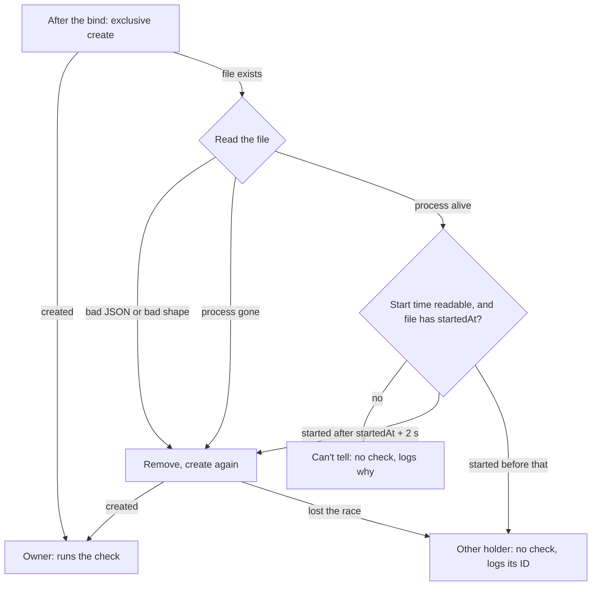

# One auto-continue owner

## What it is

The app and `pnpm dev` can share a config folder. Two servers on one folder could each send `continue` to one run. So only one server per config folder runs the automatic check. The other server still serves the board. [resume.md](resume.md) holds the rest of resume and auto-continue.

## How it works

The owner holds `<config dir>/auto-continue-owner.json`: `{ pid, id, startedAt }`, with `id` random per server. Dev and production both use it.

- **Before each check,** the owner reads the file again. Another `id`: it stops sending for good, and logs one line. File gone or bad: it creates the file again. Another read error: that check sends nothing, and the next check reads again.
- **Release.** At the end of a normal stop, after the drain, and only when the file holds its own `id`. A forced end leaves a stale file for the next start.
- **A server that isn't the owner** stays off until it restarts, also after the owner exits.
- **Not covered:** Continue and Go buttons and the toggle route act on both servers. A toggle changed on the second server reaches the owner only at its next start.

**Examples.** The file holds `{"pid":9760,"id":"eb4d…","startedAt":1793765338463}`.

- Process 9760 is the first server. A second server logs `pod-board: process 9760 runs auto-continue for <cfg>; this server won't auto-continue until it restarts`, and `/api/health` still answers.
- Process 9760 is a `node` program that started after that `startedAt`. The ID was reused, so the new server takes the file with no log line.

**Logic lives in:** `packages/server/src/owner-file.ts`, with the alive check in `parent-link.ts`.

## Why it's this way

- **A file with a process ID, not a lock service or a port.** It needs no other process, and a crash leaves a file that the next start can read as stale. Trade-off: process IDs repeat, so the file needs a start-time check.
- **Can't tell reads as not the owner.** A double `continue` is worse than no `continue`. Trade-off: auto-continue can stay off with no sign on the page.
- **A server looks only at its start.** Trade-off: a second server needs a restart to take over after the owner exits.

## Watch out

- **The start time comes from `Get-CimInstance Win32_Process`.** `Get-Process` gives no `StartTime` for another account's process unless the caller is elevated, so a stale file whose ID went to a service kept auto-continue off. A stale file is most likely after a reboot, when low process IDs repeat.
- **The page shows nothing** when this server doesn't own the check. The switch still reads on, and only the log says why. The packaged app shows that log to nobody.
- **Open queue item (now):** a PowerShell start over 5 s at login reads as can't tell. Not reproduced: about 0.8 s measured here.
- The lookup blocks the start for up to 5 s, and runs only when a live process holds the file. It starts PowerShell by its absolute path, with no window.
- Outside Windows there is no lookup, so a reused ID reads as can't tell until that process ends or you delete the file.
- A forced end, an uninstall with the app running, and `taskkill /F` on the main process each leave the file. The next start's check is the only cleanup.

## History

- 2026-11-02 · outside-terminal C1 · the owner file, in dev and production · [PR #76](https://github.com/iamphduc/pod-board/pull/76)
- 2026-11-03 · windows-app plan fix · a live process that started after the file's `startedAt` reads as a reused ID · [PR #84](https://github.com/iamphduc/pod-board/pull/84)
- 2026-11-03 · windows-app · final PR #83, verdict fix at round 2, with the service-process case open · [report](../reports/windows-app.html)
- 2026-11-03 · windows-app plan fix 2 · fixed: a stale file whose process ID went to a service process no longer turns auto-continue off. The start time of another account's process now reads without elevation.
