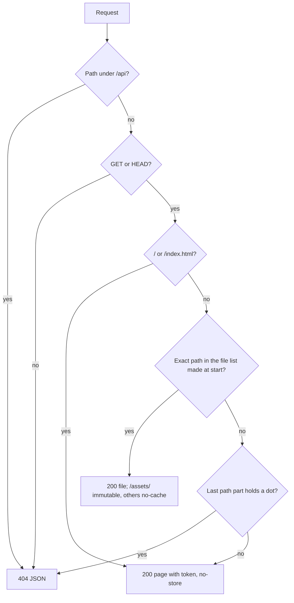

# Production start

## What it is

`pnpm build`, then `pnpm start`, runs one Node process that serves the web app and the API on one port. The desktop shell runs this same bundle. `pnpm dev` stays on two ports, with Vite and a token file. [server.md](server.md) holds the server's other rules: guards, the Board, and repo routes.

## How it works

Two entries share one wiring. `startServer` holds it. `main.ts` runs dev, and `main-production.ts` runs production and finds `web/` beside itself.

| | Dev | Production |
|---|---|---|
| Token | New per start, written to `<config dir>/session-token`; Vite puts it in the page | New per start, in memory only; the server puts it in the page |
| Port | `OPEN_AFLOW_API_PORT`, default 3000, no fallback | See below |
| `Host` and `Origin` | API port and web port | The bound port only |
| Page routes | Vite | The answer order below |
| Framing headers | `frame-ancestors 'none'` and `X-Frame-Options: DENY` from Vite | On every web answer |

**Port.** With `OPEN_AFLOW_API_PORT` unset or empty, the server tries 47800. On `EADDRINUSE` or `EACCES`, the OS picks a free port for this launch, and the log names it. With the variable set, a busy port stops the start.

**Answers, first match wins.** Every answer sits behind the request guard, and a real API route always wins.

Every web answer, a 404 too, sends `Content-Security-Policy: frame-ancestors 'none'` and `X-Frame-Options: DENY`.

**Example.** On port 3140, `GET /some/page` answers the page with `Cache-Control: no-store` and the framing headers. `GET /sw.js` answers `404 {"error":"not found"}`. A `POST` to an action route with the page's token passes the guard. With no token, it answers `403 {"error":"bad token"}`.

**The bundle.** `bundleApp` writes `packages/server/dist/app/`: `server.mjs`, with every dependency inside, and `web/`. The folder runs when you move it anywhere, with no `node_modules`.

**Logic lives in:** `packages/server/src/start-server.ts`, `web-app.ts`, `listen.ts`, and `bundle-app.ts`.

## Why it's this way

- **The token stays in memory.** A written token file would break a `pnpm dev` page open on the same config folder. Trade-off: a page from before a restart must reload.
- **A fixed port with a fallback, not a random port.** The web app's saved state belongs to the origin, so a new port each launch would lose it. Trade-off: a fixed port is a known target while the app sits in the tray.
- **A missing file answers 404, not the page.** A plain fallback to `index.html` answers `/sw.js` with `200` and HTML.
- **URL text is only a key into a file list.** It never becomes a disk path, so no spelling reaches a file outside the folder. Trade-off: a file added after the start isn't served.
- **One-file bundle through `extraResources`, not `node_modules`.** This avoids the pnpm packaging faults in the [research](../research/windows-desktop-app.md).
- **The server binds before it builds the app.** Port 0 has no number until the OS picks one, and the guards need the real port.

## Watch out

- **Open queue item (before hosting):** any local process can read the token from `GET /`, and `tool-path` then chooses the file that runs as `claude`.
- A framed page passes the guards, because it holds its own token and sends its own `Origin`. Only the headers stop it.
- `/sw.js` differs by mode: production answers 404 JSON, and dev's web port answers HTML from Vite.
- Tests never bind 47800. Set `OPEN_AFLOW_API_PORT` or pass `preferredPort`.
- `main-production.ts` run from source looks for `packages/server/src/web/` and exits 1. Never leave that folder behind.
- `/api%2fnope` answers the page, because the router doesn't decode `%2f`. It leaks nothing.
- Not proved: a real `EACCES` from Windows reserved ports, and the busy-47800 fallback through the bundle.
- Run it with temp `OPEN_AFLOW_CONFIG_DIR` and `OPEN_AFLOW_PORTS_DIR` in checks.

## History

- 2026-11-02 · one-port-server S1 · one port, the token in memory, and the port fallback · [PR #73](https://github.com/iamphduc/pod-board/pull/73)
- 2026-11-02 · one-port-server K1 · the one-file bundle, `pnpm start`, and `LICENSE` · [PR #74](https://github.com/iamphduc/pod-board/pull/74)
- 2026-11-03 · windows-app plan fix · every production web answer refuses framing · [PR #84](https://github.com/iamphduc/pod-board/pull/84)
- 2026-11-03 · windows-app · final PR #83, verdict fix at round 2, with the `pnpm dev` framing gap open · [report](../reports/windows-app.html)
