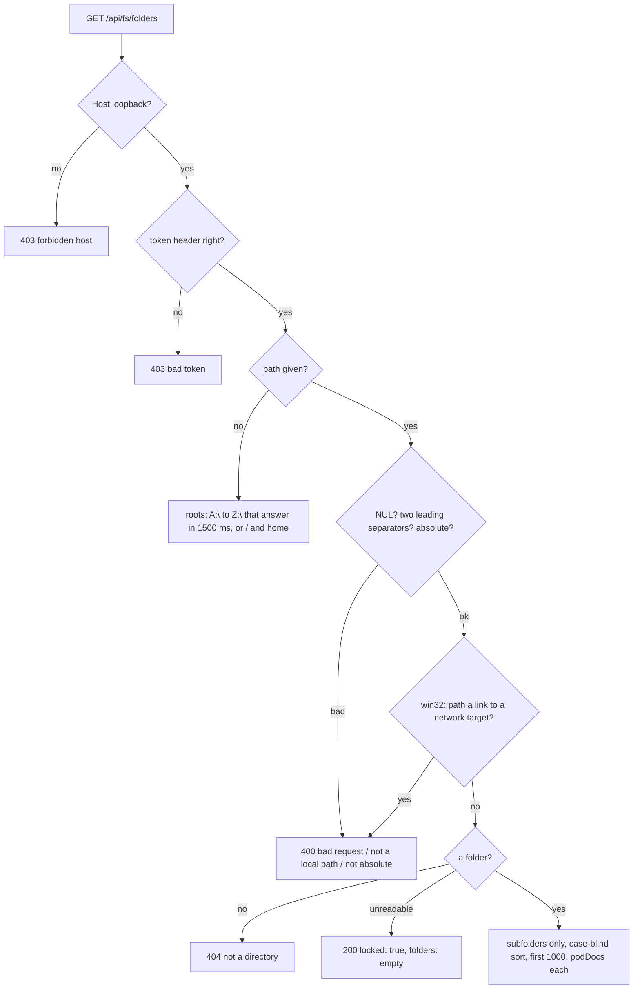

# Server

## What it is

The API server (`packages/server`) finds the repos to show, reads their pod docs, agent transcripts and port claims, asks `gh` about live PRs, builds one `Board`, keeps it current as files change, and serves it to the web app. It also lists folders for the folder picker. It writes only its own config folder (config, session token, action log, toggles, resume logs) and one line of a repo's `pod-docs/handoff-queue.md`. Covers the features.md rows API health, Board JSON, Folder listing, Live updates, Add repo, Request guard, Action token, and Error banners (server side). The actions are in [actions.md](actions.md) and [resume.md](resume.md).

## How it works

- **Repos:** paths in the config file plus every repo a claim file names, merged by normalized path (case-blind where the file system is). `source` is `registered`, `claim`, or `both`.
- **Each repo:** pod docs → the model (a doc whose real path leaves the repo's real path is skipped); recent pod-agent transcripts → parsed runs through a cache keyed by size and mtime, never text; PRs from a `gh` cache refreshed every 30 s. One bad repo sets its `error`; the others still build.
- **`gh`:** run by the absolute path of the first `gh.exe` / `gh.com` (`gh` on POSIX) in an absolute `PATH` entry; asked only about live PRs (current-sprint PRs, hand-back PRs, a fix claim's or a plan's PR by head branch).
- **Tool finder** (`tool-finder.ts`, production only; dev keeps its `PATH` lookups): finds `git`, `gh`, and `claude` when the app doesn't start from a terminal. A check only looks for a file, so it starts no tool and shows no window. First match wins, per tool:
  1. `claude` only: `POD_BOARD_CLAUDE_BIN`, with no search. No file → `bad-path`, `source: 'env'`.
  2. A path in `<config dir>/tool-paths.json`. It wins over every search. A path that fails the rules → `bad-path`, `source: 'settings'`, with no search.
  3. The inherited `Path`, absolute entries only.
  4. The registry `Path`, HKLM then HKCU, read by `reg.exe` from `SystemRoot` with no window and a 5 s limit per hive. `%VAR%` expands from the env. An entry with an unknown variable, a relative entry, or a UNC entry is dropped. A failed read counts as empty.
  5. Known folders, each skipped when its variable is unset: `Git\cmd` and `GitHub CLI` under both Program Files and `%LOCALAPPDATA%\Programs`, `%LOCALAPPDATA%\Microsoft\WinGet\Links`, `%USERPROFILE%\scoop\shims`, `\.local\bin`, and `\.claude\local`, and `%APPDATA%\npm`.

  Steps 4 and 5 run on Windows only. Extensions: `.com` and `.exe` for `git` and `gh`, also `.cmd` and `.bat` for `claude`. The first check runs before the watcher starts, and a finder failure never stops the start.
- **Path rules** (the settings file and the route), in order: no NUL (`bad request`); not two leading separators, refused before any file system call (`not a local path`); an absolute drive path (`not absolute`); a file (`not a file`); and a base name of the tool's name plus an allowed extension (`wrong tool`). The file is read at each check. Missing, unreadable, or bad JSON reads as nothing set, and a value that isn't a string is ignored.
- **Tool routes** (`tool-routes.ts`, only with the `tools` dep, so dev answers 404): `GET /api/tools`, behind the read guard, runs a new check and answers `{ tools }`, always in the order git, gh, claude. Calls during a running check share its result. `POST /api/actions/tool-path`, behind the action guard, takes `{ tool, path }` (`path: null` clears), saves through a temp file and a rename, and answers `{ tools }` from a new check. A refused path gets `400` with its word and saves nothing; a failed write gets `500 settings unwritable`. It isn't in the action log.
- **Child `Path`:** `gh` and resumed `claude` get the inherited env with `Path` = inherited absolute entries, then registry entries, then the folders of found tools, with duplicates removed (case-blind on Windows). `safeChildEnv` and `childEnv` still apply on top. Both `gh` uses read the finder at each call, so a Recheck takes effect with no restart.
- **Watching:** one watcher per folder; a rebuild after 300 ms of quiet, never later than 1.5 s after a burst starts. Clients get a Board over SSE only when its JSON changed.
- **Guards,** in order, the first failure answers:
  - every route: a loopback `Host` on the API or web port (`403 forbidden host`), and an exact `Origin` on writes. No CORS headers; both ports bind `127.0.0.1`.
  - `/api/actions/*` (remove-repo included) and `POST /api/repos` (`actionGuard`): Origin, a body over 64 KB (`413`), POST, `application/json`, the token, a JSON object.
  - `/api/fs/*` (`readGuard`): the token only, no `Origin`.
  - The token is a fresh random value per API start. In dev it's in `<config dir>/session-token`, and Vite puts it in the page's `<meta name="pod-board-token">`. In production it stays in memory, and the server puts it in the page. The page sends it as `X-Pod-Board-Token`. Compared in constant time. Never in the Board, a URL, a cookie, a log, or `pnpm build` output.
- **Two modes, one wiring** (`startServer` in `start-server.ts`; `runMain` prints a rejection as `pod-board: <message>`, exits 1, and connects the signals). `main.ts` runs dev. `main-production.ts` runs production and finds its `web` folder from `import.meta.url`, never from the working folder.

  | | Dev | Production |
  |---|---|---|
  | Token | Written to `<config dir>/session-token` before anything listens | In memory only. An existing file stays as it is, so a dev page on the same config folder keeps working |
  | Config folder | Created by the token write | Created at start; a failure stops the start, naming the folder |
  | Port | `POD_BOARD_API_PORT`, default 3000, no fallback | See **Production port** |
  | `Host` and `Origin` | API port and `POD_BOARD_WEB_PORT` | The bound port only. `POD_BOARD_WEB_PORT` isn't read |
  | Page routes | 404 on the API port | See **Production answers** |

- **Start order:** settings; the web app and config folder (production) or the token file (dev); the first tool check (production); the watcher; the bind; then the guards, the log line, and the automatic check. A failure at any step rejects, and a failed bind closes the watcher. Because the check starts after the bind, a server that can't start sends no `continue`.
- **Production port** (`listen.ts`): `POD_BOARD_API_PORT` unset or empty tries `APP_PORT` (47800). On `EADDRINUSE` or `EACCES` (Windows reserved ranges answer `EACCES`), the OS picks a free port for this launch, and the server logs `pod-board: port 47800 is busy; using <port> for this launch`. Set: that port only; busy stops the start, naming the variable and the port. Any other listen error stops the start. The guards are built with the port that was really bound.
- **Production answers** (`web-app.ts`, mounted last in `createApp`, so a real API route wins and every answer sits behind the request guard). First match wins, on the path without its query:
  1. `/api`, `/api/`, or `/api/…`, any method → 404.
  2. A method other than GET or HEAD → 404. The request guard checks `Origin` first.
  3. `/` or `/index.html` → 200, the page with the token, `no-store`.
  4. A file listed at start, by exact path → 200 with its type. `/assets/…` is `public, max-age=31536000, immutable`; any other file is `no-cache`. A listed file that has since gone → 404.
  5. A last path part that holds a dot (`/sw.js`, `/INDEX.HTML`, `/index.html::$DATA`) → 404.
  6. Anything else → the same answer as rule 3.

  Every 404 is `{"error":"not found"}`, never HTML. HEAD gets GET's status and headers with no body. The page text and the file list are read once at start; a file added later isn't served, and a missing folder, a missing `index.html`, or an `index.html` with no `</head>` stops the start, naming the folder.
- **Repo ids** (`repoIds` in `guard.ts`, one call per build, over config and claim repos together): a repo's plain id is its normalized path with each non-alphanumeric character as `-`, lowercased when its file system ignores case. Two spellings of one repo on such a file system are one entry (`sameRepoPath`), so they never clash. A repo with no clash keeps its plain id. Every member of a clash (`chess-web`, `chess_web`) gets `-` and 6 hex characters of the SHA-256 of its normalized path (case-folded where case is ignored), so an id depends only on the path and the set, never on list order. Suffixed ids that still collide, with each other or with another repo's plain id, double their suffix; the plain repo keeps its id.
- **Agents of a repo** (`agentOfRepo` in `transcript-files.ts`, per build, on the cached parse): by the first `cwd` in the session's own `<session>.jsonl`, never the agent's: an agent can work anywhere, and every agent of a session is placed the same way. Session in the repo (`isInsideRepo`, the `sameRepoPath` case rule) → listed, and it can be sent to. In a folder that, or a parent of which, folds exactly to this repo's Claude project name (a sibling or the sibling's worktree) → not listed. No session file, no `cwd` in the file's first 1 MB, or anywhere else (`chess-web-A1`) → listed, marked `sessionUnproven`, and no send. The `cwd` never reaches the Board. Each build stats each listed session file once per repo; a file whose size or mtime changed is read again, from its head only, 64 KB at a time.
- **Add repo:** a local absolute path only; a Windows path starting with two separators → `400 not a local path` before any file system call.
- **Remove repo** (`POST /api/actions/remove-repo`, `{ repoId }`, `remove-repo-routes.ts`, `repos-config.ts`): the repo comes from the current Board by id and, when sent, `path` (the page always sends it). Board ids are unique, so the `path` match (`404 not on the board`) and `409 ambiguous repo` (an id two Board repos share with no `path`; the page offers no Remove for such a repo) are safety checks that normal use doesn't reach; a claim-only repo is `404 not registered`. `removeRepo` reads `config.json` as it is now, inside the same per-file write queue as `addRepo`, takes out every entry that is the same repo by `sameRepoPath` (case per the folder's file system; a gone folder gets the OS default), and writes through the same temp file and rename. Not listed → `404 not registered`, nothing written; unreadable → `500 config unreadable`, never overwritten; a write that throws → `500 config unwritable`, logged `failed`. It never touches the repo's files, claims, or transcripts. A `both` repo leaves the config and stays on the Board through its claim. It sits under `/api/actions/` because the action guard takes only a POST; a `DELETE` would need a guard change.
- **Folder listing** (`GET /api/fs/folders[?path=]`, `folder-list.ts`, `guard.ts`, `app.ts`):

  Example: `?path=E:/Projects` → `{ path: "E:\\Projects", parent: "E:\\", locked: false, truncated: false, folders: [{ name: "pod-board", path: "E:\\Projects\\pod-board", podDocs: true }, …] }`. With no token → `403 {"error":"bad token"}`; `?path=%5C%5Chost%5Cshare` → `400 {"error":"not a local path"}`.
  - A link counts as a folder only when it ends at a local folder. On Windows each target is read with `readlink` and a network or device target is dropped before anything follows it; a linked `pod-docs` reads `false`. Files and broken links are left out. It reads names, types and link targets, never a file, and stores nothing.

## Why it's this way

- **Loopback, a Host check, and an `Origin` check for writes:** DNS rebinding is the risk even for a read-only server, and a 2026 advisory showed Host alone isn't enough for a server with write tools ([research](../research/board-actions.md)).
- **The folder listing needs the token but not an `Origin`:** it shows the whole disk's folder names, so a page on another site must not read it. Browsers leave `Origin` off same-origin GETs, so `actionGuard` (which needs one) couldn't guard it; a new `readGuard` does ([plan](../plans/calm-dashboard.md#key-decisions)).
- **Folders only, with a `pod-docs` mark, refusing UNC and device paths:** the pattern Syncthing, Jellyfin and Radarr use behind a key ([research](../research/folder-picker.md)). Opening a share on Windows can send your login to another machine, so link targets are checked before any `stat`.
- **Windows drives by trying `A:` to `Z:`:** Node has no API to list drives; a drive that doesn't answer in 1500 ms is left out (sprint contract), so one slow drive doesn't hold up the roots.
- **Add repo needs the token:** a registered repo is a folder the board reads and runs `gh` in.
- **`gh` by absolute path from absolute `PATH` entries:** a `gh.exe` planted in a cloned repo could otherwise run on the 30 s refresh.
- **A new token per launch** keeps `dist` free of it. Trade-off: a page from before a restart must reload.
- **Production's token stays in memory:** writing the file would break a `pnpm dev` page open on the same config folder ([plan](../plans/windows-app.md#key-decisions)). The page response is `no-store`, and nothing on disk holds the token.
- **A missing web file answers 404, not the page:** a fallback to `index.html` would answer `/sw.js` with `200` and HTML ([plan](../plans/windows-app.md#key-decisions)).
- **The app is built after the bind:** port 0 has no number until the OS picks one, and the guards need the real port. The server binds first, with a handler that the listening callback fills in before any connection can arrive.
- **URL text is only a key into the file list:** it never becomes a disk path, so no spelling (`%2e%2e`, `%2f`, `%5c`, `%00`, `::$DATA`) can reach a file outside the folder.
- **Quiet spell plus a cap** ([decision](../decisions.md#2026-10-19--fix-live-update-starvation-before-the-final-review)); **parsed runs, not text, in the cache** (the text cache held about 1 GB); **no transcript size cap** ([decision](../decisions.md#2026-10-23--no-size-cap-on-transcripts)).

## Watch out

- The listing checks only the last part of a typed path for a link to a share: a link in the middle (`C:\x\link\sub`) is followed (queue, someday). Making one needs admin rights and the token.
- An empty `?path=` is `400 not absolute`; leave `path` out for the roots.
- More than 1000 subfolders: `truncated: true`, and the picker can't prefix-filter past the cut (queue, someday).
- A repo's id changes when a clash forms or ends. Stored ids don't follow it: a bookmark or an old tab opens the first run; action log entries keep the old id, which only the row's React key reads (the row shows the stored repo name). An open page follows the change by path (`followRepoId` in `selection.ts`).
- Claude's project folder name (`projectDirName`) uses the same character rule as the plain id, so `chess-web` and `chess_web` read one transcript folder, even with only one of them on the board. Only the `cwd` in the session's own file tells them apart: never give a repo a session by project folder alone, by an agent's own `cwd`, or by a name prefix (`chess-web-A1` is not a sibling of `chess-web`), and never send on a session marked `sessionUnproven`.
- Compare real paths with `path.relative`, never a string prefix: `C:\x-other` starts with `C:\x`.
- Never spawn a child by a bare name with a repo as its working folder: use `resolveBin` and `safeChildEnv` (`bin-path.ts`).
- Keep Vite's dev `cors: false`. Through the proxy, a stopped API answers `502` with an empty body.
- Point `POD_BOARD_CONFIG_DIR` and `POD_BOARD_PORTS_DIR` at temp folders in tests and smoke runs. From Git Bash, send a UNC test path URL-encoded.
- The rebuild chain must never stay rejected; keep the cap timer apart from the quiet timer.
- Ctrl+C waits up to 70 s for running actions; don't wait for `server.close()` (open SSE streams keep it from finishing).
- Tests never bind 47800: set `POD_BOARD_API_PORT` or pass `preferredPort`.
- `/sw.js` differs by mode: production answers 404 JSON, and dev's web port still answers it with HTML from Vite. Only production's rules live in `web-app.ts`.
- Until the owner file ships, production and dev on one config folder can both auto-continue. Use separate config folders in checks.
- The finder stats `Path` entries with sync calls, as `resolveBin` always has: a dead mapped drive on `Path` blocks the server for that check.
- After a Recheck finds `gh`, the Board's `gh` status can read `missing` for up to 60 s, until the auth recheck is due.
- `reg.exe` prints in the console's code page. A literal non-ASCII folder in the registry `Path` can read wrong and not match. The inherited `Path`, the known folders, and a typed path still find the tool.
- The bundle's own tests can find a real `gh` through the registry or a known folder, even with an empty `PATH`. To keep a test offline, seed `tool-paths.json` with fakes.
- `main-production.ts` run from source looks for `packages/server/src/web/`, which doesn't exist, so it exits 1. The bundle puts `web/` beside the entry.

## History

- 2026-10-18 · server-runs A1: board service, watcher, SSE, and repo routes.
- 2026-10-19 · board-engineer T1: agent timeline route.
- 2026-10-19 · board-engineer X1: `configError` on the Board; `livePrNumbers` uses the model's `handBackPr`; the server imports the model's contract types.
- 2026-10-19 · board-engineer wave 2 fix: config edits reach the board through the watcher; poll mode waits one poll interval longer before a rebuild; a new `ghCheckedAt` counts as a change while `gh` isn't `ok`.
- 2026-10-19 · board-engineer wave 2 fix 2: a rebuild waits at most 1.5 s after a burst's first event, so steady edits still reach clients.
- 2026-10-19 · board-read · plan complete; final PR held at gate 2 for a dispatch bug outside the server · [report](../reports/board-read.html)
- 2026-10-19 · board-read fix 2: `/api/board` no longer serves agent descriptions.
- 2026-10-19 · board-read fix 5: the board count for a quick burst is tested with a fake watch over real files; the real-file test checks only the 5 s bound and the last board.
- 2026-10-20 · board-read · final review passed at round 5; every server row driven live · [report](../reports/board-read.html)
- 2026-10-20 · fix-closeout-idle: `livePrNumbers` also asks about a claimed archived plan's hand-back PR, so its Ship step can read merged.
- 2026-10-20 · fix-show-fix-runs: `gh` also finds a fix claim's PR by its head branch (`getBranch`), so a fix run's Ship step reads `you merge` or `merged`.
- 2026-10-21 · fix-final-pr-early: `gh` also finds a plan's final PR by head branch `<plan-slug>` while the plan is in its final review or close-out with no hand-back, so Ship shows it before the hand-back exists.
- 2026-10-21 · fix-cache-transcripts: the board keeps each transcript's parsed run, not its text, and parses only files whose size or mtime changed. On a real `~/.claude`: heap after the first board 986 MB → 13 MB, a rebuild with nothing changed 5 s → 69 ms. The timeline route reads its file fresh.
- 2026-10-21 · merge-actions S1: per-launch session token, the action guard on `/api/actions/`, the page's token meta, and the action client. Vite's dev CORS turned off.
- 2026-10-21 · merge-actions M1: merge-preview and merge routes; `ExecResult.stderr`, a per-call exec timeout, and `GhCache.forget`; `Board.actions` from the action log.
- 2026-10-21 · queue-and-replies A1: `POST /api/actions/answer`, the server's one write into a repo's queue.
- 2026-10-22 · board-actions · plan complete: action token, `Origin` check, and the action guard on every action route; final PR #33 passed review at round 2 after fix PR #34 · [report](../reports/board-actions.html)
- 2026-10-22 · fix-security-hardening: `gh` runs by an absolute path from absolute `PATH` entries only (a `gh.exe` in a repo could run); `POST /api/repos` needs the session token and refuses UNC and device paths unread.
- 2026-10-23 · fix-hardening-2: pod docs whose real path leaves the repo are skipped; `/api/actions/*` and `POST /api/repos` bodies over 64 KB get `413`.
- 2026-10-25 · fix-background-loops: a watch that fails to open or close is logged, and later rebuilds still run.
- 2026-10-25 · test-main-boot: `main.test.ts` starts the real API from `main.ts` on temp folders and checks health, the Board, the token file, and the action guard; on macOS and Linux also a clean exit on SIGTERM.
- 2026-10-25 · fix-shutdown-drain: Ctrl+C waits for running merges, answers, resumes, and auto-continue sends before exiting, so their action-log lines aren't lost; a second Ctrl+C quits now.
- 2026-10-28 · calm-screen F1: `GET /api/fs/folders` (the folder listing for the picker) behind a new read guard on `/api/fs/*`; the token compare is shared with the action guard.
- 2026-10-28 · calm-dashboard · plan complete: the folder listing and its read guard ship with the folder picker; final PR #54 passed review at round 1 · [report](../reports/calm-dashboard.html)
- 2026-10-30 · fix-run-flow · the repo read adds `pod-docs/decisions.md` and the `.md` reports directly in `pod-docs/research` (same real-path and size rules); gh reads each PR's `baseRefName`, and `refresh` takes staging heads (`stagingBranches`) that are asked about every 30 s even after a merge, since every plan reuses the staging branch.
- 2026-10-30 · fix-run-flow review round 1 · gh also reads each PR's `mergedAt` (read-only `--json`), so a staging PR can be told apart from the last plan's by merge time.
- 2026-11-01 · fix-remove-repo · added: `POST /api/actions/remove-repo` takes a repo out of `config.json` (same queue and atomic write as Add repo, matched by Repo identity, from the file as it is now) and logs `remove-repo` entries.
- 2026-11-01 · fix-remove-repo review round 1 · fixed: Remove picks the exact repo by id and path; an id two repos share is `409 ambiguous repo` without a path, and the menu offers no Remove for it.
- 2026-11-02 · fix-repo-id · fixed: repos whose paths differ only in symbols get unique ids, so every action reaches the repo you targeted and the page offers Remove for them.
- 2026-11-02 · fix-repo-id review round 1 · fixed: a repo lists an agent by a `cwd`, so a sibling's session is never offered or sent, and no readable `cwd` sends nothing. Remove forgets the repo's auto-continue toggles.
- 2026-11-02 · fix-repo-id review round 2 · fixed: the owner comes from the session's own file, not the agent's transcript; only an exact fold of the project name hides an agent; Remove forgets toggles also for a repo a port claim still lists.
- 2026-11-02 · fix-repo-id review round 3 · fixed: a failed read of a session file (a lock, say) is no longer kept as "no `cwd`"; the session stays unproven only until a later build can read it.
- 2026-11-02 · one-port-server S1: the wiring moved from `main.ts` to `startServer` and `runMain`; a production mode serves the web app and the API on one port, with the token in memory and a port fallback. A busy port now stops dev with an error naming the variable, and the automatic check starts after the bind.
- 2026-11-02 · outside-terminal T1: the tool finder, `GET /api/tools`, and `POST /api/actions/tool-path`, in production only. `gh` and resumed `claude` read the finder at each call and get a merged `Path`.
