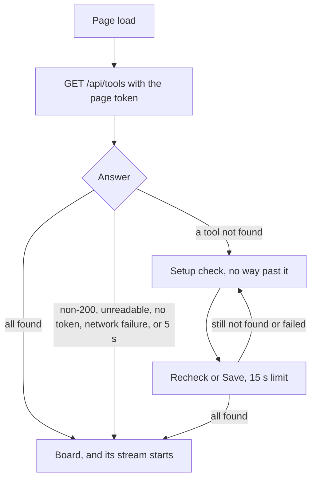

# Setup check

## What it is

The production page first asks which tools the server can find. If `git`, `gh`, or `claude` isn't found, a screen replaces the board. It says what's missing and how to fix it. `pnpm dev` never shows this screen.

## How it works

**Find order, first match wins per tool.** A check only looks for a file. It starts no tool and shows no window.

1. `claude` only: `OPEN_AFLOW_CLAUDE_BIN`, with no search.
2. A path in `<config dir>/tool-paths.json`.
3. The inherited `Path`, absolute entries only.
4. The registry `Path`, HKLM then HKCU, through `reg.exe` with a 5 s limit.
5. Known folders: Git, GitHub CLI, WinGet, scoop, `.local\bin`, `.claude\local`, and `%APPDATA%\npm`.

**Rows.** `found` shows its path. `missing` shows an install link and a path field. `bad path` shows the path, what to do, and a field. A `bad path` from `OPEN_AFLOW_CLAUDE_BIN` names the variable and has no field.

**Routes (production only; dev answers 404).** `GET /api/tools` needs the token and runs a new check. `POST /api/actions/tool-path` takes `{ tool, path }`, and `path: null` clears. A refused path gets `400` with one word: `bad request`, `not a local path`, `not absolute`, `not a file`, or `wrong tool`.

**Children.** `gh` and resumed `claude` read the finder at each call, so a Recheck needs no restart. Their `Path` is inherited entries, then registry entries, then the found tools' folders.

**Example.** `tool-paths.json` holds `{"claude":"C:/temp/no-such/claude.cmd"}`. The screen shows `git` and `gh` as `found` and `claude` as `bad path`, with the path and a field. Create that file and press Recheck. The board opens.

**Logic lives in:** `packages/server/src/tool-finder.ts`, `tool-routes.ts`, and `packages/web/src/screens/setup/setup-client.ts` and `setup-view.ts`.

## Why it's this way

- **A path in settings beats every search.** So a typed path can fix any fault in the search. The plan's overview listed settings last; the `outside-terminal` contract moved it first. Trade-off: a saved path that goes bad stops the search until the field is cleared.
- **The finder merges the registry `Path`, and doesn't trust the inherited one.** A stale `PATH` on a Start-menu launch was an inference in the plan, so the design doesn't rest on it.
- **The check never runs a tool.** So a check shows no window. Trade-off: a broken tool reads `found`.
- **A slow or failed check opens the board.** A hung check must not lock anyone out. Trade-off: a check over 5 s shows the board with a tool missing.
- **No setup row for pod.** [Agent default](../decisions.md#2026-11-03--pod-in-the-setup-check-agent-default--override-anytime). The install note and the no-runs states give pod's install step instead.
- **Recheck's `gh` delay is accepted.** [Agent default](../decisions.md#2026-11-03--recheck-and-the-boards-gh-field-agent-default--override-anytime). The Board's `gh` field can read `missing` for up to 30 s after a Recheck finds it.

## Watch out

- `SETUP_NOTE` says resumed runs drop `CLAUDE*` variables set only in a shell, but three stay. `docs/install.md` is correct. Following the note still works (queue, someday).
- `reg.exe` prints in the console code page, so a non-ASCII registry folder can read wrong. A typed path still works (queue, before hosting).
- Saving an empty field clears the saved path. That's the only way back to the search. The field also strips the quotes of Copy as path.
- A dead mapped drive on `Path` blocks the server during a check, because the finder uses sync stats.
- Keep `SystemRoot` in any stripped env: without it, the registry read counts as empty, and `listen` fails in a `utilityProcess`.
- The bundle's tests can find a real `gh` through the registry or a known folder, even with an empty `Path`. Seed `tool-paths.json` with fakes.
- Not run: `missing` rows from the real finder, because this machine always finds its tools. They were seen with a stubbed reply.
- The sidebar card of a repo with no pod reads `update pod`. The model can't tell no pod from an older pod (queue, someday).

## History

- 2026-11-02 · outside-terminal T1, L1 · the tool finder, the tool routes, the merged `Path`, and the styles · [PR #75](https://github.com/iamphduc/pod-board/pull/75)
- 2026-11-02 · outside-terminal U1 · the setup check screen and its gate · [PR #76](https://github.com/iamphduc/pod-board/pull/76)
- 2026-11-03 · windows-app plan fix · the install note and the no-runs states name pod and its install step · [PR #84](https://github.com/iamphduc/pod-board/pull/84)
- 2026-11-03 · windows-app · final PR #83, verdict fix at round 2 · [report](../reports/windows-app.html)
- 2026-11-05 · fix-rename-open-aflow · renamed: the setup check intro and the env-path fix ("then restart Open AFlow") say Open AFlow.
