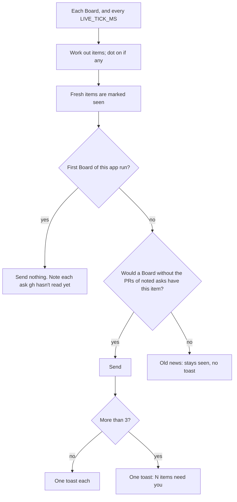

# Toasts

## What it is

The Electron shell's notifier reads the live Board in the main process, so it works while the window is hidden. It sends a Windows toast when something new needs the human, and it sets the tray dot. See [desktop.md](desktop.md) for the shell.

## How it works

**Items.** For each run of `listRuns(board, now)`, take `card` plus `rest` of the web's `nextSteps`, and keep the tiers `blocked`, `merge`, and `reply`. `pending` and `info` never count. These cases give no item of their own:

- a reply on a PR that is already a merge item of that run
- a `continue` on a run with auto-continue on and a session, because the board sends it itself. An old `fix-merged` is an item, because the board won't send it (`autoMaySend`)
- a `fix-merged` whose key the run's toggle already sent (`lastKey` on `Board.autoContinue`), by the board or by your press. The key is saved before the start. A send that started and then stalled has only its card
- anything from a repo in `error` or `unsupported`

One case overrides the two auto-continue rules above: when a toggled run's send of a stop fails to start, by the board or by your press, the toggle's `lastFailed` raises that stop as an item on any run, until a send of it starts. The board won't retry that key. It sends a toast only when this app run hasn't shown that item yet. Otherwise only the dot comes back

**Identity.** `<repoId>\n<key>`, where the key is `entry:<line>`, `pr:<number>`, or the model's key for one stop. The seen set lasts the app run and only grows.

**Old news arriving late.** An item is part of the baseline if only a `gh` read that hadn't happened at the first Board could name it. There is no timer.

- Each repo on the Board has `ghReads`: one row per PR the server asks about, by number or by head branch, with `read`. A failed read isn't a read. A branch list with no PR is. The read mark and the PR land in the same moment, so a Board never shows a read with its PR missing.
- The first Board notes every row with `read: false`. A later ask is never noted.
- Each pass works out the items twice: on the Board, and on the Board without the PRs of noted asks. A fresh item that only the first has is old news: it is marked seen, the dot counts it, and no toast sends. This covers a reply too, such as the `Send continue` a merged PR asks for.
- A noted row leaves the list on the Board that shows it read. So only its first read is old news: a later change sends.
- A row that goes missing from a Board stays noted, because a half-saved doc can drop it for one Board.
- A staging ask comes from another PR's base, so a noted read that found a PR also notes the staging asks that are unread on that Board.

**Old PR read late, or new PR?** The ask tells them apart. Its first read was still to come at the first Board: old. Its first read came earlier and found no PR, or the ask came up after the first Board: new.

**The stream.** A `fetch` of `GET /api/events` on the shell's port. Bad JSON is skipped. A failed or closed stream retries after 5 s. 45 s with no bytes counts as lost. `host.onReady` moves it to a new port. The clock waits while the stream is lost.

**A toast.** The title is the run's name, and the body is the item's title. Each send logs `openaflow desktop: toast sent`, with no entry text.

**A click.** The toast's XML (`toastXml`) has `launch="openaflow-toast:<hash>"`. A click on a live banner reaches the toast's `click` event and `Notification.handleActivation`. Both call `bus.showWindow(hash)`, which is safe to repeat. A click in the notification center reaches only `handleActivation`: Windows calls the activator (COM, by the CLSID on the Start-menu shortcut) with the `launch` text. A `launch` that isn't ours, such as on a toast from 0.1.0, opens the window on no run. A packaged app registers the activator at its start, with its own shortcut's CLSID (`activatorClsid`). So a click also works before this run's first toast, and on an app that isn't running: Windows starts it with `-Embedding`, which is a normal start.

**Example.** The app starts offline, with a queue `BLOCKED` open and the staging branch's PR #901 open on GitHub. The first Board marks the `BLOCKED` seen, lights the dot, and notes the staging ask. No toast. `gh auth status` fails, so `gh` reads `logged-out`. At 8 s a slice's row becomes `#78 | pushed`: the docs name that merge, so one toast sends at once. An hour later `gh` comes back, and the first read finds #901: seen, no toast. Later a new `BLOCKED` line arrives: one toast, and one log line. A click opens that run. After the human answers it, the plan's `Send continue` reply appears and sends one more toast.

**Logic lives in:** `packages/desktop/src/attention.ts`, `notifier.ts`, `board-stream.ts`, and `toast-activation.ts`. The read marks are in `packages/server/src/gh.ts` and `board-service.ts`.

## Why it's this way

- **The run in the toast's `launch`, not a table in memory.** A toast outlives the app run, and a file of ids would need its own cleanup. Trade-off: the shell writes the toast's XML itself, so it must escape the text and drop what XML can't hold: control characters, U+FFFE, U+FFFF, and a surrogate with no partner. One of these makes Windows refuse the whole toast, and the log reads `toast sent`, then `toast failed`.
- **One rule set.** `attention.ts` imports `nextSteps`, `hashFor`, and `runName` from `@openaflow/web`. Turned down: a copy of the rules. Trade-off: the web package exports three pure subpaths, and the shell must import only those.
- **`fetch`, not `EventSource`.** The main process has no `EventSource`, and `/api/events` needs only a loopback `Host`. So the shell never holds the token.
- **Only three tiers.** `pending` entries aren't urgent enough to interrupt. Trade-off: a pending decision never toasts.
- **Each item gets one try.** It is marked seen before its send, so a send that throws can't repeat on every tick.
- **A summary over 3 new items.** Agent default, so a burst doesn't fill the screen.
- **The server's reads, not a timer.** Only the server knows when a read ended, and a timer was wrong both ways: an offline start sent old PRs, and a new doc-named merge got no toast. Turned down: a longer hold, and a hold on the `merge` tier, because the docs alone can name a merge. Trade-off: one more field on the Board, and one more Board event when a read finds nothing.
- **A toast after you answer a `BLOCKED`.** [Agent default](../decisions.md#2026-11-03--toast-after-you-answer-a-plans-blocked-agent-default--override-anytime): it tells you a run can go on. Turned down: no toast for a reply you just caused.

## Watch out

- **A toast's `click` event ends when the toast leaves the screen.** Holding the `Notification` object doesn't help: a real activation after `close` fired no `click` on a held object. Only `handleActivation` hears it, and only the `launch` text says which run, because Electron's own toast has no `launch`.
- **Nothing registers the activator until the first `Notification` call.** Electron starts with a random CLSID, and takes the shortcut's CLSID only at that call. Before it, a click starts a second copy, which loses its run to the single-instance lock. That is why the shell calls `Notification.isSupported()` at the start.
- **That first call writes a Start-menu shortcut named for the exe,** so an unpackaged run would leave `Electron.lnk` at each start. Only a packaged app makes the call at its start (`activatorAtStart`). `real-toast.test.ts` turns it on and removes what it leaves.
- **Each new shortcut CLSID leaves a key** under `HKCU\Software\Classes\CLSID`, and uninstall doesn't remove it. Each toast from an unpackaged run or a temp install has left one. The key does nothing once its exe is gone.
- **A PR that opens while `gh` is out reads as old, on an ask noted at the first Board.** Its first read is the only sign of it, so that first read can't tell "opened at 9:00" from "opened last week". The same holds for a PR that merged while `gh` was out. No toast sends, but the dot and the card show it. A PR on an ask that came up after the first Board, or whose first read found no PR, always sends.
- **A really new staging PR can go quiet.** This happens only if its ask first shows on the same Board where a noted read found a PR.
- **A forgotten PR doesn't wait again.** A merge route's `forget` and a server restart both set `read` back to false. Only the first Board of an app run notes asks, and the seen set still covers what already showed.
- A PR `gh` can never read (a folder with no remote) stays `read: false` for good. It can't name an item, so this costs one Board row.
- A repo added after the start isn't in the baseline, so its open items send.
- A repo id change, or a queue line someone edits, sends again, because the identity changes.
- Never import `@openaflow/web`'s `.tsx` files or its package root. `notifier.test.ts` checks that the main bundle holds no React.
- An unpackaged toast can leave `Electron.lnk` in the Start menu, with the app's AppID, and `Get-StartApps` then lists `Electron`. Delete it after a run. A friend's machine has no unpackaged run.

### Human list

`pnpm test:install` proves the Start-menu AppID and one `toast sent` on the installed app. No agent can see the items below. Do them after the last proof, because a real install stops the proofs. First delete `Electron.lnk` if it exists, then run `pnpm package`, run the installer, and open OpenAFlow from the Start menu.

1. Register a temp copy of the mock repo, and add a `BLOCKED · orchestrator → human` line to its queue. A toast shows, with the name `OpenAFlow` and its icon.
2. Hide the window. Add a second such line, and click its banner while it shows. The window opens on that run.
3. Hide the window. Add a third line, and wait for its banner to leave the screen. Click it in the notification center. The window opens on that run.
4. Quit from the tray. Click the toast from step 3 in the notification center. The app starts and opens on that run. If nothing opens, read `%APPDATA%\OpenAFlow\desktop.log`.
5. Right-click the tray icon. The menu holds Open and Quit, and their labels line up.
6. The taskbar and `OpenAFlow.exe` show the app icon.
7. A normal install opened the app by itself. Run the same installer again with the app open: one copy of the app runs after it ends.

To uninstall: Settings, Apps, Installed apps, OpenAFlow, Uninstall.

## History

- 2026-11-03 · windows-app plan fix · fixed: old items that only `gh` can name no longer send at every app start. The baseline holds merge and reply items until `gh` has answered or reads as unavailable.
- 2026-11-03 · windows-app · final PR #83, verdict fix at round 2, with the hold's timing open · [report](../reports/windows-app.html)
- 2026-11-03 · windows-app plan fix 2 · fixed: the 20 s hold is gone. The baseline now comes from gh's first read of each PR (`ghReads` on the Board). An old PR stays quiet when `gh` comes back, and a new doc-named merge sends at once.
- 2026-11-04 · fix-late-merge-continue · fixed: a click on a toast in the notification center opened nothing. The toast now carries its run, and `Notification.handleActivation` opens it, also from a closed app.
- 2026-11-04 · fix-late-merge-continue review · fixed: a queue line with U+FFFE, U+FFFF, or a surrogate with no partner sent no toast. Those characters now leave the toast, and an emoji stays.
- 2026-11-05 · fix-rename-open-aflow · renamed: a toast shows the app name Open AFlow, from the `Open AFlow.lnk` Start-menu shortcut and the app ID `com.alvionlabs.openaflow`.
