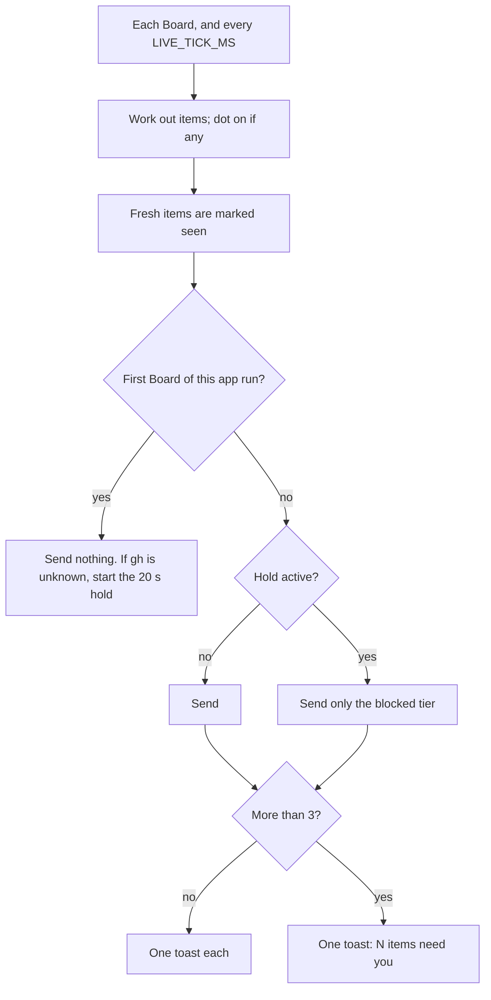

# Toasts

## What it is

The Electron shell's notifier reads the live Board in the main process, so it works while the window is hidden. It sends a Windows toast when something new needs the human, and it sets the tray dot. See [desktop.md](desktop.md) for the shell.

## How it works

**Items.** For each run of `listRuns(board, now)`, take `card` plus `rest` of the web's `nextSteps`, and keep the tiers `blocked`, `merge`, and `reply`. `pending` and `info` never count. These cases give no item of their own:

- a reply on a PR that is already a merge item of that run
- a `continue` on a run with auto-continue on and a session, because the board sends it itself
- anything from a repo in `error` or `unsupported`

**Identity.** `<repoId>\n<key>`, where the key is `entry:<line>`, `pr:<number>`, or the model's key for one stop. The seen set lasts the app run and only grows.

**The hold today.** A first Board with `gh: 'unknown'` holds merge and reply items for 20 s, and again for 20 s from gh's first `ok`. `missing` or `logged-out` ends it at once. See **Watch out**: this rule has an open finding.

**The stream.** A `fetch` of `GET /api/events` on the shell's port. Bad JSON is skipped. A failed or closed stream retries after 5 s. 45 s with no bytes counts as lost. `host.onReady` moves it to a new port. The clock waits while the stream is lost.

**A toast.** The title is the run's name, and the body is the item's title. A click calls `bus.showWindow(hashFor(run))`. Each send logs `pod-board desktop: toast sent`, with no entry text.

**Example.** The app starts with a queue `BLOCKED` open and gh not yet answered. The first Board marks it seen and lights the dot, with no toast. At 3 s gh reads `ok`, and an old PR #901 arrives: seen, no toast, because the hold runs to 23 s. At 30 s a new `BLOCKED` line arrives: one toast, and one log line. A click opens that run. After the human answers it, the plan's `Send continue` reply appears and sends one more toast.

**Logic lives in:** `packages/desktop/src/attention.ts`, `notifier.ts`, and `board-stream.ts`.

## Why it's this way

- **One rule set.** `attention.ts` imports `nextSteps`, `hashFor`, and `runName` from `@pod-board/web`. Turned down: a copy of the rules. Trade-off: the web package exports three pure subpaths, and the shell must import only those.
- **`fetch`, not `EventSource`.** The main process has no `EventSource`, and `/api/events` needs only a loopback `Host`. So the shell never holds the token.
- **Only three tiers.** `pending` entries aren't urgent enough to interrupt. Trade-off: a pending decision never toasts.
- **Each item gets one try.** It is marked seen before its send, so a send that throws can't repeat on every tick.
- **A summary over 3 new items.** Agent default, so a burst doesn't fill the screen.
- **A toast after you answer a `BLOCKED`.** [Agent default](../decisions.md#2026-11-03--toast-after-you-answer-a-plans-blocked-agent-default--override-anytime): it tells you a run can go on. Turned down: no toast for a reply you just caused.

## Watch out

- **Open finding (PR #83, round 2): the hold's timing is wrong in both directions.** The Board doesn't say when gh's first read ended, so a timer stands in for it.
  - An old toast still sends. `gh auth status` fails offline, and that reads as `logged-out`, which ends the hold. Auth is asked again only after 60 s. Repro: a stub that fails until 15 s gave `toast sent` at 91 s, with nothing changed on disk. A failed first PR read does the same.
  - A really new item gets no toast. A sprint doc alone names a merge item, but the hold passes only the `blocked` tier. Repro: a slice set to `#78 | pushed` 8 s after the listening line gave 0 toasts in 70 s.
  - The reviewer's suggested fix: a Board field that says gh's first read of each PR is done, in place of the timer. The 20 s hold is a queue decision that the reviewer says isn't a safe default.
- A repo added after the start isn't in the baseline, so its open items send.
- A repo id change, or a queue line someone edits, sends again, because the identity changes.
- Never import `@pod-board/web`'s `.tsx` files or its package root. `notifier.test.ts` checks that the main bundle holds no React.
- An unpackaged toast can leave `Electron.lnk` in the Start menu, with the app's AppID, and `Get-StartApps` then lists `Electron`. Delete it after a run. A friend's machine has no unpackaged run.

### Human list

`pnpm test:install` proves the Start-menu AppID and one `toast sent` on the installed app. No agent can see the items below. Do them after the last proof, because a real install stops the proofs. First delete `Electron.lnk` if it exists, then run `pnpm package`, run the installer, and open Pod Board from the Start menu.

1. Register a temp copy of `E:\Projects\pod-trial-mock`, and add a `BLOCKED · orchestrator → human` line to its queue. A toast shows, with the name `Pod Board` and its icon.
2. Wait for it to leave the screen. Click it in the notification center. The window opens on that run.
3. Turn on Start at login, then sign out and in. The tray icon shows, and no window opens.
4. The taskbar and `Pod Board.exe` show the app icon.

To uninstall: Settings, Apps, Installed apps, Pod Board, Uninstall.

## History

- 2026-11-03 · windows-app plan fix · fixed: old items that only `gh` can name no longer send at every app start. The baseline holds merge and reply items until `gh` has answered or reads as unavailable.
- 2026-11-03 · windows-app · final PR #83, verdict fix at round 2, with the hold's timing open · [report](../reports/windows-app.html)
