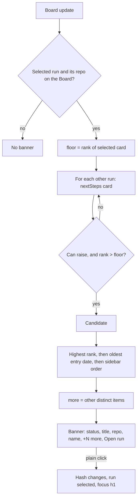

# Urgent banner

## What it is

One line at the top of screen 1's main column. It shows when another listed run's Next step card is more urgent than the selected run's card. It names that item and its run, adds a `+N more` pill and a stack behind it when other runs also outrank, and has one control: "Open run". When nothing outranks the selected run, it takes no space and screen 1 looks as before. Screen 1 views only (`pipeline` and a fix run's `agent` view), never the wave board or the engineer view.

**Look:** the banner takes its item's status colour: a 10 % fill and a 50 % border (red for `Blocked`, amber for `Needs you`, green for `Ready`). The status word takes the same colour with a little `--fg` mixed in, and the title is weight 500. Any other status keeps the plain box. "Open run" is a text button with no box until hover.

**Stack:** with `more` ≥ 1, empty `aria-hidden` layers sit behind the banner, stepped 8 px down and right: one layer for `more` = 1, two for `more` ≥ 2, never more. Each layer copies the card's fill, border and height. The card gives up 8 or 16 px on the right, so the stack's right edge stays on the column's edge. The 24 px gap to the run header is measured from the lowest layer. With `more` = 0 there is no layer and no margin change.

**Count:** `+N more` is a pill right before "Open run": 24 px tall, 500-weight Geist Mono 13 px, `--fg` text on `color-mix(in srgb, var(--tone) 24%, var(--bg))`. It still reads as text in the status region. It counts every other outranking item, not only the same tier.

**Narrow layout:** the layout follows the banner's own width, through a container query on `.urgent-slot`, because the 400 px sidebar stays beside the column down to an 821 px viewport (a 325 px column).

| Column width | With a count | With no count |
| --- | --- | --- |
| Above 760 px | One line. The title gives way first; the run and repo take up to 50 % of the text. | The same |
| 621–760 px | One line, repo hidden. The run takes up to 40 % of the text. | One line, with the repo |
| 521–620 px | Stacked. Row 1: the status and the pill. Row 2: the text, wrapping, repo hidden. Row 3: "Open run", full width and 44 px tall. | One line, with the repo |
| 520 px and below | Stacked | Stacked: the same rows, with no pill |

The switches are measured with a long title and a long run name. The status, the pill and the button never shrink.

| Column | Case | Layout | Title |
| --- | --- | --- | --- |
| 761 | `Needs you`, `+99 more` | One line, repo | 27 characters |
| 760 | `Needs you`, `+99 more` | One line, no repo | 32 characters |
| 621 | `Needs you`, `+99 more` | One line, no repo | 21 characters |
| 620 | `Needs you`, `+99 more` | Stacked | Wraps |
| 528 | `Blocked` / `Needs you`, no count | One line, repo | 19 / 18 characters |
| 521 | `Blocked` / `Needs you`, no count | One line, repo | 19 / 18 characters |
| 520 | `Blocked` / `Needs you`, no count | Stacked | Wraps |

## How it works

On each Board update (server-sent events), `RunsScreen` calls `elsewhere(runs, board, selected, now)` from `packages/web/src/screens/runs/elsewhere.ts`. The picker keeps no state.

1. For every listed run, it reads only `nextSteps(run, repo, now).card`, never `rest`. A run whose repo is missing is skipped.
2. Rank by tier: `blocked` 4, `merge` 3, `reply` 2, `pending` 1, `nothing` 0.
3. Another run's card can raise a banner if its tier is `blocked`, `merge` or `reply`, or `pending` and it stops its run (`stopsRun`), of any kind. An entry with no plan heads only a repo row's card: from there a BLOCKED raises a banner, a gate doesn't.
4. It must rank strictly higher than the selected card. A selected entry pod goes on without ranks 0, like `nothing`.
5. Winner: the highest rank. In `blocked` and `pending`, the oldest entry date wins (an undated entry loses). Then the earlier run in the sidebar wins.
6. `more` counts the other outranking items. A run is matched by `repoId` plus item `key`, so an item counts once.

The banner renders inside a `.urgent-slot` with `role="status"`. The slot is always there on screen 1 and is empty when there is no winner, so a new item is announced once. "Open run" is a link to `hashFor(run)`; the app's hash routing selects the run. A plain click also stores the target hash, and focus moves to the run's `h1` only when that run arrives.

**Worked example** (mock repo `pod-trial-mock`). Selected: `no-sprints`, card "Nothing to do", so the floor is 0. `old-plan` has a `BLOCKED` halt dated 2026-10-30 (rank 4). `three-sprints` has a `BLOCKED` halt dated 2026-10-31 (rank 4). `all-done` is "Nothing to do" (rank 0, can't raise). Both blocked cards outrank; the older date wins. Result: `Blocked · Autopilot stopped: the wave check failed · pod-trial-mock · An old finished plan +1 more [Open run]`. On `old-plan`, `three-sprints` is the same tier, so the slot is empty.

**Logic lives in:** `elsewhere.ts` (pick), `open-focus.ts` (`opensHere`, `focusOnArrival`), `UrgentBanner.tsx` (line and layers), `urgent-banner.css` (layout, stack, and the tone from the status class), `RunsScreen.tsx` (slot, focus effect).

## Why it's this way

- **A banner, not a card across all runs.** The human picked placement B, above the run header. Turned down: a box in the sidebar (A), and a line inside the Next step card (C). It reverses a calm-dashboard turn-down. See [decisions.md](../decisions.md#2026-11-01--urgent-items-from-other-runs-show-as-a-banner-reverses-calm-dashboard).
- **Only each run's card, ranked by `nextSteps` tiers.** The banner, the card and the sidebar dots can't disagree on what is next. Turned down: ranking every waiting item, which would surface items the run's own card doesn't lead with.
- **Navigation only, no dismiss.** Actions stay on the target run's card. A dismiss could hide a real block; it is parked as [an idea](../ideas/urgent-banner-dismiss.md).
- **Tinted by status, with a text button.** The human found the plain box too subtle and the boxed button nested, and picked look B of [draft 2](../design-drafts/next-step-across-runs-look-2.html). Turned down: half the tint (C) and a left edge (D). See [decisions.md](../decisions.md#2026-11-01--urgent-banner-tinted-by-status-human-reversed-no-coloured-fill-or-border-for-the-banner-only).
- **A stack and a pill for the others.** The human on the muted count: "the plus one is too subtle to notice". The human picked stack A of [draft 3](../design-drafts/next-step-across-runs-look-3.html) and option 4 of [draft 4](../design-drafts/next-step-across-runs-look-4.html). See [decisions.md](../decisions.md#2026-11-01--urgent-banner-stacks-other-items-and-shows-the-count-as-a-pill).
- **A container query, not a viewport rule.** The column can be narrower than a phone's at a viewport far above 480 px.
- **Separate switches for a banner with no count.** It keeps today's one line and repo until its title would drop below about 20 characters, because it needs no room for a pill or layers. The trade-off is a second block of the same rules; `urgent-banner.test.ts` keeps the two blocks the same.
- **A link, not a button.** Ctrl+click and middle click open a new tab, and Back works. The trade-off is the focus rule below.
- Agent defaults, each with its turned-down option, in decisions.md: [repo hidden on phones](../decisions.md#2026-11-01--urgent-banner-hides-the-repo-on-phones-agent-default--override-anytime), [`+N more` counts distinct items](../decisions.md#2026-11-01--urgent-banner-n-more-counts-distinct-items-agent-default--override-anytime), [a selected someday card ranks as pending](../decisions.md#2026-11-01--a-selected-someday-card-still-ranks-as-pending-agent-default--override-anytime), [the title gives way first at 800–1024 px](../decisions.md#2026-11-01--urgent-banner-cuts-the-title-first-on-mid-width-screens-agent-default--override-anytime).

## Watch out

- The banner never holds Answer, Merge, Close, Keep, Continue, Go or Copy, and never calls an action route. `urgent-banner.test.ts` pins this.
- Screen 1 keeps one `btn primary`, on the Next step card. "Open run" is `btn sm quiet trail`, not primary.
- `.urgent-slot` needs `min-width: 0`. It is a grid item of `.main`; without it a long title widens the column and the page scrolls sideways.
- `.urgent-slot` must have no padding, margin, border, gap or min-height, so an empty slot takes no space. It is the `urgent` container with inline size only, so its height stays 0 when empty.
- The layers use a negative `z-index`, so `.urgent-slot` holds the stacking context (`isolation: isolate`). `.urgent` must never become a stacking context (no `isolation`, `transform`, `opacity`, `filter` or `z-index`): its own layers would then paint over its fill.
- The layers sit inside `.urgent`, not in a wrapper, so `--tone` reaches them and `
` stays the root. They copy the card with `inherit`; don't give them their own colours.
- `.urgent` sets `--tone: var(--muted)` as the default. Without it, a status with no tone leaves the pill's `color-mix` invalid, and the pill has no fill.
- Change the 520, 620 or 760 px switch only after you measure again with the worst case: `Needs you`, `+99 more` and a long title and run name. Every rule in the 620 and 760 px blocks must name `.urgent-more`, so a banner with no count ignores them.
- A change to the stacked rows goes in both the 620 and the 520 px blocks.
- Don't reuse `.banner` or `.banners`: those are the error notices.
- The focus target is a hash, not a flag. Set it only when `opensHere(e)` is true. A boolean set on every click let a Ctrl+click steal focus on the next run change (review round 1).
- The selected run is matched by `hashFor`, not object identity.
- The 9 px label-to-arrow gap comes from `.btn.trail`, and every trail button shares it (queue, someday).
- The tone comes from `.urgent:has(> .status.s-bad)` and its `s-you` and `s-ok` rules, because `runs-screen.test.ts` pins the exact markup `
`. A new status class gets no tint until it has a rule.
- `.btn.quiet` is muted in `base.css`. `.urgent-open.btn.quiet` sets the label back to `--fg`; don't drop it.

## History

- 2026-11-01 · next-step-across-runs · added: the elsewhere picker, the one-line banner above the run header, and focus on the opened run's title; Ctrl+click no longer moves focus (review fix) · [report](../reports/next-step-across-runs.html), [PR #67](https://github.com/iamphduc/pod-board/pull/67)
- 2026-11-01 · fix-urgent-tint · changed: the banner is tinted by status, and "Open run" is a text button (look B of draft 2) · [PR #70](https://github.com/iamphduc/pod-board/pull/70)
- 2026-11-01 · fix-urgent-stack · changed: other items stack behind the banner, the count is a pill beside "Open run", and the narrow layout follows the banner's own width (stack A of draft 3, option 4 of draft 4) · [PR #71](https://github.com/iamphduc/pod-board/pull/71)
- 2026-11-03 · fix-run-state · changed: a pending card raises a banner only when it stops its run (`stopsRun`), of any kind, instead of by the kinds `now`, `decision` and `before`. A selected card pod goes on without ranks 0, so a stop elsewhere still shows. An entry with no plan raises none, unless it is a BLOCKED to you, a halt gate or a hand-back.
- 2026-11-03 · fix-run-state review round 1 · changed: an entry with no plan no longer heads a plan or fix run's card, so it raises no banner from one; a plan-less gate raises none from a repo row either.
