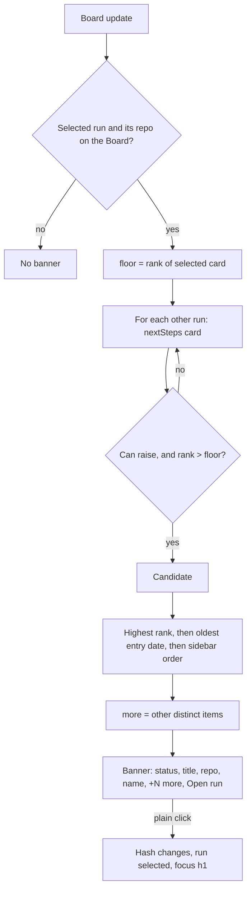

# Urgent banner

## What it is

One line at the top of screen 1's main column. It shows when another listed run's Next step card is more urgent than the selected run's card. It names that item and its run, adds `+N more` when other runs also outrank, and has one control: "Open run". When nothing outranks the selected run, it takes no space and screen 1 looks as before. Screen 1 views only (`pipeline` and a fix run's `agent` view), never the wave board or the engineer view.

**Look:** the banner takes its item's status colour: a 10 % fill and a 50 % border (red for `Blocked`, amber for `Needs you`, green for `Ready`). The status word takes the same colour with a little `--fg` mixed in, and the title is weight 500. Any other status keeps the plain box. "Open run" is a text button with no box until hover; on a phone it is full width and 44 px tall.

## How it works

On each Board update (server-sent events), `RunsScreen` calls `elsewhere(runs, board, selected, now)` from `packages/web/src/screens/runs/elsewhere.ts`. The picker keeps no state.

1. For every listed run, it reads only `nextSteps(run, repo, now).card`, never `rest`. A run whose repo is missing is skipped.
2. Rank by tier: `blocked` 4, `merge` 3, `reply` 2, `pending` 1, `nothing` 0.
3. Another run's card can raise a banner if its tier is `blocked`, `merge` or `reply`, or `pending` with kind `now`, `decision` or `before`.
4. It must rank strictly higher than the selected card. The selected card ranks by tier alone.
5. Winner: the highest rank. In `blocked` and `pending`, the oldest entry date wins (an undated entry loses). Then the earlier run in the sidebar wins.
6. `more` counts the other outranking items. A run is matched by `repoId` plus item `key`, so a shared entry counts once.

The banner renders inside a `.urgent-slot` with `role="status"`. The slot is always there on screen 1 and is empty when there is no winner, so a new item is announced once. "Open run" is a link to `hashFor(run)`; the app's hash routing selects the run. A plain click also stores the target hash, and focus moves to the run's `h1` only when that run arrives.

**Worked example** (mock repo `pod-trial-mock`). Selected: `no-sprints`, card "Nothing to do", so the floor is 0. `old-plan` has a `BLOCKED` halt dated 2026-10-30 (rank 4). `three-sprints` has a `BLOCKED` halt dated 2026-10-31 (rank 4). `all-done` is "Nothing to do" (rank 0, can't raise). Both blocked cards outrank; the older date wins. Result: `Blocked · Autopilot stopped: the wave check failed · pod-trial-mock · An old finished plan +1 more [Open run]`. On `old-plan`, `three-sprints` is the same tier, so the slot is empty.

**Logic lives in:** `elsewhere.ts` (pick), `open-focus.ts` (`opensHere`, `focusOnArrival`), `UrgentBanner.tsx` (line), `urgent-banner.css` (layout, and the tone from the status class), `RunsScreen.tsx` (slot, focus effect).

## Why it's this way

- **A banner, not a card across all runs.** The human picked placement B, above the run header. Turned down: a box in the sidebar (A), and a line inside the Next step card (C). It reverses a calm-dashboard turn-down. See [decisions.md](../decisions.md#2026-11-01--urgent-items-from-other-runs-show-as-a-banner-reverses-calm-dashboard).
- **Only each run's card, ranked by `nextSteps` tiers.** The banner, the card and the sidebar dots can't disagree on what is next. Turned down: ranking every waiting item, which would surface items the run's own card doesn't lead with.
- **Navigation only, no dismiss.** Actions stay on the target run's card. A dismiss could hide a real block; it is parked as [an idea](../ideas/urgent-banner-dismiss.md).
- **Tinted by status, with a text button.** The human found the plain box too subtle and the boxed button nested, and picked look B of [draft 2](../design-drafts/next-step-across-runs-look-2.html). Turned down: half the tint (C) and a left edge (D). See [decisions.md](../decisions.md#2026-11-01--urgent-banner-tinted-by-status-human-reversed-no-coloured-fill-or-border-for-the-banner-only).
- **A link, not a button.** Ctrl+click and middle click open a new tab, and Back works. The trade-off is the focus rule below.
- Agent defaults, each with its turned-down option, in decisions.md: [repo hidden on phones](../decisions.md#2026-11-01--urgent-banner-hides-the-repo-on-phones-agent-default--override-anytime), [`+N more` counts distinct items](../decisions.md#2026-11-01--urgent-banner-n-more-counts-distinct-items-agent-default--override-anytime), [a selected someday card ranks as pending](../decisions.md#2026-11-01--a-selected-someday-card-still-ranks-as-pending-agent-default--override-anytime), [the title gives way first at 800–1024 px](../decisions.md#2026-11-01--urgent-banner-cuts-the-title-first-on-mid-width-screens-agent-default--override-anytime).

## Watch out

- The banner never holds Answer, Merge, Close, Keep, Continue, Go or Copy, and never calls an action route. `urgent-banner.test.ts` pins this.
- Screen 1 keeps one `btn primary`, on the Next step card. "Open run" is `btn sm quiet trail`, not primary.
- A sidebar dot can read `needs you` for a run with only `someday` entries, and that run raises no banner. That is correct: the dot follows state, the banner follows urgency.
- `.urgent-slot` needs `min-width: 0`. It is a grid item of `.main`; without it a long title widens the column and the page scrolls sideways.
- `.urgent-slot` must have no padding, margin, border, gap or min-height, so an empty slot takes no space.
- Don't reuse `.banner` or `.banners`: those are the error notices.
- The focus target is a hash, not a flag. Set it only when `opensHere(e)` is true. A boolean set on every click let a Ctrl+click steal focus on the next run change (review round 1).
- The selected run is matched by `hashFor`, not object identity.
- The 9 px label-to-arrow gap comes from `.btn.trail`, and every trail button shares it (queue, someday).
- The tone comes from `.urgent:has(> .status.s-bad)` and its `s-you` and `s-ok` rules, because `runs-screen.test.ts` pins the exact markup `
`. A new status class gets no tint until it has a rule.
- `.btn.quiet` is muted in `base.css`. `.urgent-open.btn.quiet` sets the label back to `--fg`; don't drop it.

## History

- 2026-11-01 · next-step-across-runs · added: the elsewhere picker, the one-line banner above the run header, and focus on the opened run's title; Ctrl+click no longer moves focus (review fix) · [report](../reports/next-step-across-runs.html), [PR #67](https://github.com/iamphduc/pod-board/pull/67)
- 2026-11-01 · fix-urgent-tint · changed: the banner is tinted by status, and "Open run" is a text button (look B of draft 2) · [PR #70](https://github.com/iamphduc/pod-board/pull/70)
