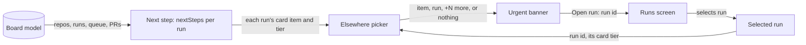
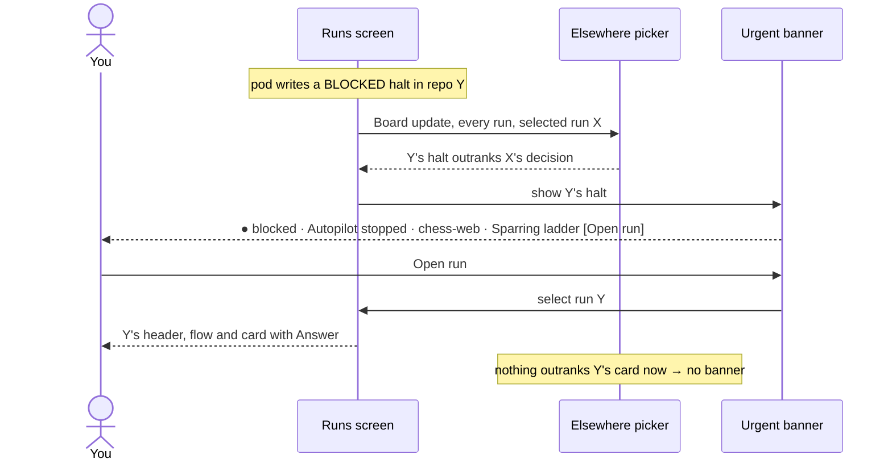

# Plan: Next step across runs

_Generated: 2026-10-31 · Status: archived · Grilled-with: pod (fast)_

Port base: 3000

<!-- autopilot-run: started=2026-11-01T18:09:29Z sprints=1 waves=1 -->

## Goal
When another run needs you more urgently than the run you're looking at, screen 1 says so in one line at the top of the main column, with a button that opens that run. When nothing outranks the selected run, the page looks exactly as it does today.

## Why
- With several repos running, the only sign that another run is blocked or waits for a merge is a status dot in the sidebar. The human wants an urgent item in another run shown where they read first: "If it's urgent, I think the B should be the right way to show for user."
- This reverses one turned-down item of the `calm-dashboard` plan ("a card across all runs; the runs list already marks other runs"). The calm rule still holds: the banner shows only when another run outranks the selected run's card, and it carries no actions.

**Success criteria:**
- With run X selected and its card a pending decision, a blocked run Y shows a banner above X's header within 5 seconds of pod writing the halt. "Open run" selects Y, and Y's card shows the halt with its Answer button.
- With no other run outranking X's card, no banner shows and the page matches today's screen 1.
- At 375 px the banner fits without sideways scroll, and its button is a 44 px touch target.

**Constraints:**
- The banner is navigation only: it never answers, merges, closes, keeps or sends a reply.
- It picks from the same model rules as the Next step card (`nextSteps`), so the banner, the card and the sidebar dots can't disagree.
- Look, tokens and fonts stay as in the `calm-dashboard` Look. CLAUDE.md layout, button and 4 px spacing rules apply.
- No new server route and no new data in the Board JSON.

## Scope
**In scope:**
- A pure module in the web app that, from every listed run, finds the most urgent item in a run other than the selected one, and whether it outranks the selected run's card.
- The banner on screen 1, above the run header, at desktop and phone widths, in both themes.
- "Open run" selects that run; keyboard and screen-reader support.
- Docs: `features.md` row and `feature-details/runs-and-pipeline.md`; a `decisions.md` entry that records the reversal.

**Out of scope:**
- Browser or OS notifications, a tray icon, a phone ping (master plan phase 3).
- A count in the browser tab title.
- Actions in the banner (Answer, Merge, Close, Keep, Continue).
- A dismiss button or snooze.
- The banner on the wave board (`/board`) and the engineer view.
- Changes to the sidebar run cards or their status dots.

## How it fits together
The web app gains one pure module and one small component. The model and the server don't change: the module calls the existing `nextSteps` for each listed run and compares the results.

**Parts:**

| Part | New or changed | Where (existing folder or module) | Does |
|------|----------------|-----------------------------------|------|
| Elsewhere picker | new | `packages/web/src/screens/runs/` (pure view module) | From every listed run's `nextSteps`, picks the most urgent item outside the selected run, and says whether it outranks the selected run's card; counts the other runs that also outrank it |
| Urgent banner | new | `packages/web/src/screens/runs/` (component and its styles) | One line: status dot and word, the item's title, the run's name and repo, `+N more` when more runs outrank, and an "Open run" button |
| Runs screen | changed | `packages/web/src/screens/runs/` | Places the banner above the run header and selects the run on "Open run" |
| Next step | unchanged | `packages/web/src/screens/runs/` (`nextSteps`) | Same tiers and kinds as today; the picker reads it for every run |

**How they connect:**

**Main flow:** you look at run X; run Y becomes blocked; the banner appears; you open Y and answer from its card.

**Data:** nothing new is stored. The picker reads the Board the page already receives over server-sent events. The selected run stays where screen 1 keeps it today.

## Sprint sequence

| Sprint | Goal | Status | Depends on |
|--------|------|--------|------------|
| urgent-banner | The elsewhere picker, the urgent banner on screen 1, and its docs | done | — |

Status: `planned` / `active` / `done`. `Depends on` is the only dependency between sprints.

## Look
The human picked **B · Banner above the run**: "If it's urgent, I think the B should be the right way to show for user." The board's look doesn't change; this places one new element in it.
- **Thesis:** an urgent item elsewhere reads first, in one quiet line, and goes away when it's no longer more urgent.
- **Palette:** the `calm-dashboard` tokens, no new colors. Banner: border `--border-strong` (`#3a3a3a` / `#d4d4d4`), background `--bg`, text `--fg` (`#ededed` / `#171717`), run and repo `--muted` (`#a1a1a1` / `#666666`), status dot in its status color (blocked `#ff5f5f` / `#d0262f`, needs you `#f5a623` / `#b25d00`, ready `#3ecf72` / `#1a8a45`).
- **Type:** Geist and Geist Mono as today: the item title 14 px Geist, the status word and the repo 12–13 px Geist Mono.
- **Layout:** desktop: the first child of the main column, as wide as the column, one line: status dot and word, the item's title, `· <repo> · <run name>` muted, `+N more` muted when it applies, and "Open run" (a small secondary button with the arrow icon) at the right end; 8 px corner radius, 8 px by 16 px padding (the button side less). At 820 px and below it stays at the top of the main column, below the stacked sidebar. At 480 px and below it wraps: the text on one or two lines, then "Open run" full width and 44 px tall. A long title ends in an ellipsis on desktop and wraps on phones.
- **Signature detail:** it exists only while another run truly outranks the one you're on; otherwise screen 1 is exactly today's.
- **Rules out:** a colored fill or colored border on the banner; action buttons in it; a close button; animation beyond the existing breathing dot; text glyphs as icons.
- **Draft:** [`pod-docs/design-drafts/next-step-across-runs-look.html`](../design-drafts/next-step-across-runs-look.html) (direction B picked).
- **Later picks:** stack A of [draft 3](../design-drafts/next-step-across-runs-look-3.html) and count option 4 of [draft 4](../design-drafts/next-step-across-runs-look-4.html), with the narrow layout following the banner's own width.
- **Changed 2026-11-01:** after this plan, the human picked look B of [draft 2](../design-drafts/next-step-across-runs-look-2.html): the banner is tinted by status and "Open run" is a text button. This replaces "Rules out: a colored fill or colored border" and the 8 px by 16 px padding, for the banner only. See [decisions.md](../decisions.md#2026-11-01--urgent-banner-tinted-by-status-human-reversed-no-coloured-fill-or-border-for-the-banner-only).

## Key decisions
- **Reverse the calm-dashboard "no card across all runs" decision, as a banner, not a card.** The human chose to show urgent items from other runs where they read first. The selected run's card stays the selected run's own. Record this in `pod-docs/decisions.md` when the sprint lands.
- **Banner placement B** (human's pick): above the run header in the main column. Turned down: A (a box at the top of the sidebar) and C (a line inside the Next step card).
- **What outranks** (default): each run's card item from `nextSteps`, by tier: blocked → merge → reply → pending. Another run's item shows only when its tier is strictly higher than the selected run's card; any action item outranks a "Nothing to do" card. A pending entry counts only when its kind is `now`, `decision` or `before …`; `someday`, `other` and answered entries never raise a banner. (default)
- **Which one, when several outrank** (default): the highest tier wins; within a tier, the oldest item (entry date; a PR or reply counts by the run's order in the sidebar); the banner adds `+N more` for the other runs that also outrank. (default)
- **Navigation only** (default): "Open run" selects the run. The run's own card holds the action, so actions stay in one place.
- **No dismiss** (default): the banner leaves when the item is handled or no longer outranks.
- **Screen 1 only** (default): not on the wave board or the engineer view.
- **Accessibility** (default): the banner is a `role="status"` region (polite), so a new urgent item is announced once; "Open run" names the run (`Open run Sparring ladder`); after it, focus moves to the run header.
- **No web research** (default): the feature reads pod's own data, and the parked idea already defined it.
- **Built on PR #59 and #63** (the card's kinds and tiers) and alongside PR #64 (Close and Keep, another agent's): the banner doesn't show Close or Keep; the target run's card does.

## Known risks
- **Another agent changes screen 1 at the same time** (`fix-sidebar-resize` touches `RunsScreen.tsx`, `runs.css` and the runs list; PR #64 touches the card and the Waiting tab). Mitigation: start the sprint from the latest `pod-staging` after those land, keep the banner in its own module and component, and run the full verify on the merged result before the PR.
- **Cost of computing `nextSteps` for every run on every Board update.** Mitigation: it's pure and the runs list is short (a handful of runs); memoize per Board if a measurement shows it matters.
- **Flicker when items change quickly** (a run's item resolves while another appears). Mitigation: the banner follows each Board update as the card does; no animation, so a change is a plain swap.
- **Disagreement with the sidebar dot** (a run reads `needs you` but has only `someday` entries, so no banner). Mitigation: document it; the dot follows the run's state, the banner follows urgency.

## Open questions
- none

## Verification
- With a fixture or the mock repo holding two runs, X selected with a pending decision and Y with a `BLOCKED` halt: the banner shows Y's halt above X's header; "Open run" selects Y and Y's card shows the halt with Answer.
- With Y's only item a `someday` entry, or an item of the same tier as X's card, no banner shows.
- With X's card "Nothing to do" and Y waiting for a merge, the banner shows Y's merge.
- With three runs outranking X, the banner shows the highest and `+2 more`.
- The banner has no Answer, Merge, Close, Keep or Continue button, and no close button.
- At 1440 px and 375 px, in dark and light themes: no sideways scroll, text contrast at least 4.5:1, "Open run" 44 px tall at 480 px and below, all spacing on the 4 px scale.
- `pnpm verify` passes; the picker's tier, kind and tie rules have table tests.

## Queue log

- `[2026-11-01 · PENDING · engineer → human · plan: next-step-across-runs · sprint: urgent-banner · slice: U1]` decision: at 480 px and below the urgent banner hides `· <repo>` and shows only `· <run name>`, matching the draft's 375 px shot; the contract named both with no phone exception. Value in use: repo hidden on phones (PR https://github.com/iamphduc/pod-board/pull/66). **Resolution:** 2026-11-01 — default recorded: repo hidden on phones; override anytime ([decisions.md](decisions.md#2026-11-01--urgent-banner-hides-the-repo-on-phones-agent-default--override-anytime))
- `[2026-11-01 · PENDING · engineer → human · plan: next-step-across-runs · sprint: urgent-banner · slice: U1]` decision: the urgent banner's `+N more` counts distinct items, so two runs of one repo sharing one unjoined entry count once even behind another winner (the rule's literal reading counts runs). Value in use: distinct items (PR https://github.com/iamphduc/pod-board/pull/66). **Resolution:** 2026-11-01 — default recorded: distinct items; override anytime ([decisions.md](decisions.md#2026-11-01--urgent-banner-n-more-counts-distinct-items-agent-default--override-anytime))
- `[2026-11-01 · PENDING · orchestrator → human · plan: next-step-across-runs · sprint: urgent-banner]` decision: when the selected run's card is a pending `someday` or `other` entry, it still ranks as `pending`, so another run's pending `decision` raises no banner (only blocked, merge and reply do). The other reading treats such a card as "Nothing to do". Value in use: rank by tier (PR https://github.com/iamphduc/pod-board/pull/66). **Resolution:** 2026-11-01 — default recorded: rank by tier; override anytime ([decisions.md](decisions.md#2026-11-01--a-selected-someday-card-still-ranks-as-pending-agent-default--override-anytime))
- `[2026-11-01 · PENDING · reviewer → human · plan: next-step-across-runs]` decision: at 800–1024 px the urgent banner cuts the title first while `· <repo> · <name> +N more` (up to 50 %, `urgent-banner.css`) stays whole, as the Look says ("the title gives way first"). Value in use: title gives way first (PR https://github.com/iamphduc/pod-board/pull/67). **Resolution:** 2026-11-01 — default recorded: title gives way first; override anytime ([decisions.md](decisions.md#2026-11-01--urgent-banner-cuts-the-title-first-on-mid-width-screens-agent-default--override-anytime))
- `[2026-11-01 · PENDING · orchestrator → human · plan: next-step-across-runs]` plan next-step-across-runs complete — final PR https://github.com/iamphduc/pod-board/pull/67, review pass, 5 open entries sorted in the hand-back **Resolution:** 2026-11-12 — final PR merged
