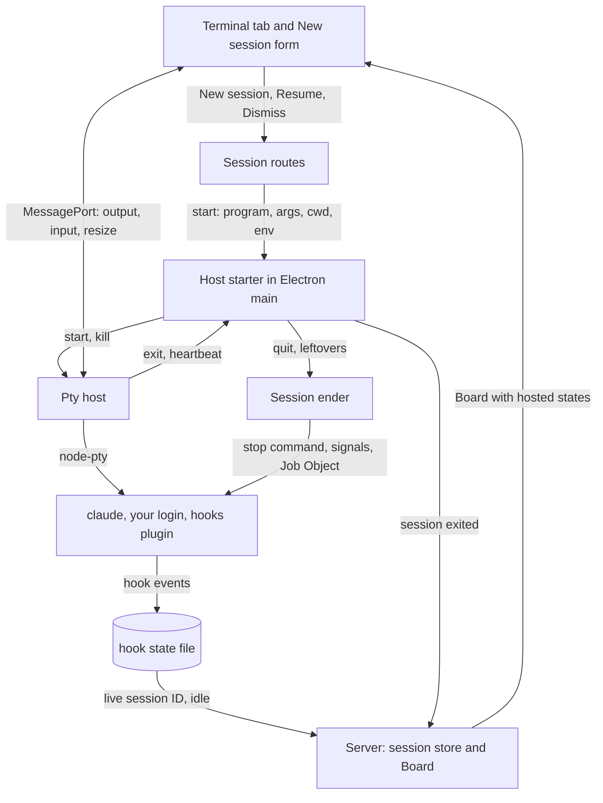
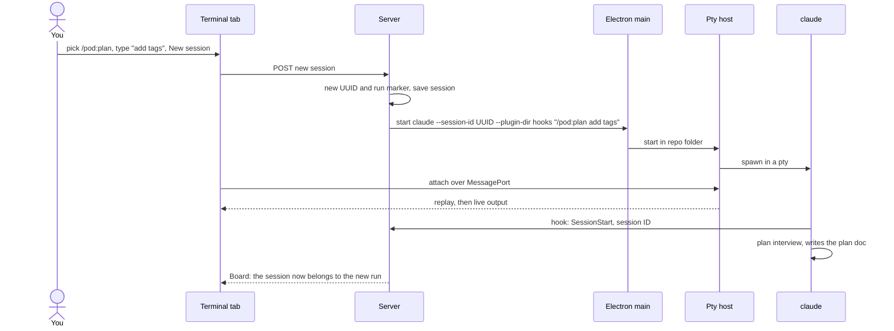

# Plan: Terminal host

_Generated: 2026-11-13 · Status: active · Grilled-with: pod (fast)_

## Goal
OpenAFlow hosts its own terminals. Each terminal runs the real, unmodified `claude` with your own login. You start, watch, type into, resume, and end sessions in the app, so you use OpenAFlow only and no separate terminal. This is plan A of three: `terminal-host`, then `openaflow-plugin`, then `automatic-input`.

## Why
The human, on 2026-11-13: "Without terminal host, this app is just a monitor tool. People still have to run Claude Code and run this app at the same time, which I won't even want to use. The goal is to have people use this app only and still manage everything else."

Success for this plan: in the installed app on Windows and on Linux, you pick a pod skill, start a session, work in it in the Terminal tab, close and reopen the window with no loss, quit with a confirm that leaves no `claude` or child process running, and resume the session after a restart.

Constraints:
- v0.1.0 waits for this plan and `openaflow-plugin` (human, 2026-11-13).
- Finish PR #108 (`ui-rework`) first: this plan builds on its run screen. Resume it with `/pod:autopilot`.
- Design and decisions come from the research: [terminal-host.md](../research/terminal-host.md), [terminal-host-spike.md](../research/terminal-host-spike.md), [automatic-input.md](../research/automatic-input.md), and [vscode-terminal.md](../research/vscode-terminal.md). Of its decisions 1–25, this plan puts 1, 3–7, 10–12, and 18–24 in force. Decisions 2, 8, and 25 (`.openaflow/`) go to `openaflow-plugin`; 9 and 13–17 (automatic input) go to `automatic-input`.

## Scope
**In scope:**
- A pty host: a second Electron `utilityProcess` with `node-pty@1.2.0-beta.18` (pinned) and a headless xterm buffer per session. Start, write, resize, kill, list, replay, heartbeat. The window talks to it through `MessagePort` only.
- Packaging node-pty outside the asar, proved on Windows and Linux, packaged and unpackaged.
- A small OpenAFlow hooks plugin, no skills, loaded with `--plugin-dir`. Its hooks write the live session ID (with its cause) and hook state to a file in the app's config folder, keyed by the run's `OPENAFLOW_RUN` marker.
- **New session:** a dropdown of pod skills (`/pod:plan`, `/pod:ship`, `/pod:task`, `/pod:research`, `/pod:idea`, and Plain session) plus one text field. The app starts `claude --session-id <uuid> "/pod:<skill> <text>"` in the repo.
- The Terminal tab beside Waiting and Log, on a run and on a repo row with no plan. A terminal joins the run whose session it holds.
- Run states for hosted sessions: live, stopped (app closed, terminals restarted), ended, can't resume, waiting on the folder-trust prompt. **Resume** and **Dismiss**.
- The Next step card on a hosted run: **Open terminal** with "type `continue`" instead of a send.
- Session life: window close and reopen, server restart, host crash (restart up to 5 times), app crash, reboot, heartbeat banner, screens saved every 10 s.
- Quit: native dialog with **Cancel** as the default; "Ending N sessions…"; SIGHUP, SIGTERM, SIGKILL in parallel; process tree plus env marker; the default systemd scope on Linux; a Job Object on Windows. Leftovers ended after a host crash and at the next start after an app crash.
- Updates: install only on a quit with no live session, or after the same quit dialog.
- A settings page: Open at login, scrollback (5,000 lines default), and on Linux and macOS the run wrapper and stop command with a preview and **Reset to default**.
- Linux as a real target: a CI job on `ubuntu-latest` with `xvfb`, the Add repo folder dialog checked on Linux, and queue item 2026-11-05 (`utimes` after each config copy on POSIX, so `pruneLogs` keeps the right resume logs), which was due "before the Linux release".
- The browser build (decision 24): no Terminal tab and no New session form. A hosted run shows its state and its stop bar's words, with "Open the desktop app to use the terminal." in place of the buttons. Engineers check the non-terminal UI there, and the Terminal tab, New session, and Resume through the `_electron` checks.

**Out of scope:**
- Any automatic input into a hosted session: auto-continue, the send path, the gate, and their tests. Plan `automatic-input` (after v0.1.0).
- The `.openaflow/` folder, the claude-pod fork as OpenAFlow's plugin, and moving the hard-coded `pod-docs/` paths. Plan `openaflow-plugin` (before v0.1.0).
- The typing-wait setting (decision 9). It belongs to `automatic-input`.
- macOS builds and tests.
- A full run-screen redesign. The new UI fits the current screen.
- Changes to runs started in your own terminal: they stay watch-only with today's `claude -p --resume` runner (decision 7).

## How it fits together

**Parts:**

| Part | New or changed | Where (existing folder or module) | Does |
|------|----------------|-----------------------------------|------|
| Pty host | new | `packages/pty-host` | Holds every terminal: node-pty, a headless buffer per session, replay, heartbeat. Knows nothing of plans or pod. |
| Host starter | new | `packages/desktop` (next to the server host) | Starts the pty host, restarts it up to 5 times, watches the heartbeat, hands each window a `MessagePort`. |
| Session ender | new | `packages/desktop` | Ends a session's process tree: stop command, tree and marker snapshot, SIGHUP, SIGTERM, SIGKILL; Job Object on Windows. Runs at quit and on leftovers. |
| Quit and update flow | changed | `packages/desktop` (quit, updater) | Quit dialog, "Ending N sessions…", install updates only after it. |
| Session store | new | `packages/server` | Per session: repo, session ID, run marker, start time, stop reason, last saved screen. In the config folder. |
| Session routes | new | `packages/server` (action routes) | New session, Resume, Dismiss. Builds the `claude` command line; the window never does. |
| Hooks plugin | new | `packages/hooks-plugin` (shipped in the app) | Writes the live session ID and hook state per run marker. |
| Run model join | changed | `packages/model` (runs) | Attaches a hosted session to its run or repo row; reports the hosted states. |
| Resume runner | changed | `packages/server` (resume, auto-continue) | Refuses any `-p` send to a hosted session. |
| Terminal tab | new | `packages/web` screens/runs | xterm.js view on the `MessagePort`, stop bar, Resume, Dismiss, Open terminal. |
| New session form | new | `packages/web` screens/runs | Skill dropdown, text field, start. |
| Settings page | new | `packages/web` (new screen), `packages/desktop` (login item) | Open at login, scrollback, run wrapper, stop command. |

**How they connect:**

**Main flow:** you start a plan from a repo with no plan.

**Data:**
- **Session store** (`<config dir>/sessions.json`, server writes, server reads): repo path, run marker, live session ID, start time, stop reason, path of the last saved screen.
- **Saved screens** (`<config dir>/screens/<run marker>.txt`, host writes every 10 s and at quit, server reads for the stop bar).
- **Hook state** (`<config dir>/hooks/<run marker>.jsonl`, hooks plugin writes, server reads): session ID changes with their cause, and the hook events the later `automatic-input` plan needs.
- **Settings** (`<config dir>/settings.json`, server writes and reads; main reads the login item): scrollback, run wrapper, stop command. Never in a repo.

## Sprint sequence

| Sprint | Goal | Status | Depends on |
|--------|------|--------|------------|
| host-core | The pty host, node-pty, the hooks plugin, and packaging, proved on Windows and Linux; a session starts and replays | planned | — |
| terminal-tab | New session with the skill dropdown, the Terminal tab, and the hosted run states on the current run screen | planned | host-core |
| session-life | Quit, ending process trees, Resume, crashes, the heartbeat banner, and updates | planned | terminal-tab |
| settings | The settings page: Open at login, scrollback, run wrapper, and stop command | planned | session-life |

## Look
No new look. The human checked the new screens in the current look on 2026-11-13 ("The rest design looks very nice to me") and asked for one change: a skill dropdown in New session, now drawn in the draft.
- **Thesis, palette, type, and layout:** as in `DESIGN.md` and `packages/web/src/theme/tokens.css`. No new tokens.
- **Terminal:** background `--surface`, text `--fg`, cursor `--focus`, font `--mono` at 13 px, in light and dark.
- **Terminal tab:** after Waiting and Log, closed until opened, with a status dot when a session is live.
- **New session:** a "Start with" dropdown (label, slash command, one line on what it does), a text field, and a primary **New session** button.
- **Stop bar:** status dot, stop word, one muted line, **Resume** (primary) and **Dismiss**; the last screen faded below it.
- **Settings:** opened from the sidebar foot beside Add repo and from the tray; replaces the main column, with **Back**; each change saves at once.
- **Rules out:** a custom terminal theme, a new palette, a new kind of sidebar row.
- **Draft:** `pod-docs/design-drafts/terminal-host-look.html` (the current look, revised with the skill dropdown).

## Key decisions
- **Three plans in a row.** pod reviews code once at plan end, with at most 4 sprints, so the terminal host splits: this plan, then `openaflow-plugin`, then `automatic-input`. v0.1.0 waits for the first two (human, 2026-11-13).
- **No release before the terminal host** (human, 2026-11-13). This holds v0.1.0 past the `ui-rework` plan's "before v0.1.0".
- **node-pty, upstream `1.2.0-beta.18`, pinned** ([decision](../decisions.md)). The human's Windows test passed with node-pty; the agents there suggested another library, and the human chose to keep node-pty and fix problems later. Fallback: `@lydell/node-pty`.
- **The research's decisions 1, 3–7, 10–12, and 18–24 take effect here.** 2, 8, and 25 take effect in `openaflow-plugin`; 9 and 13–17 (typing wait, draft rule, and the send path) in `automatic-input`. Decision 7 applies here only in its watch-only part; outside runs write `.openaflow/` once `openaflow-plugin` lands.
- **A hooks-only plugin now.** Following the session ID after `/clear` needs `SessionStart`. The plugin ships in the app and loads with `--plugin-dir` (spike check 11). `openaflow-plugin` later folds it into the full plugin. (default)
- **No automatic input in this plan.** A hosted session gets no automatic send and no `-p` send. **Continue** on a hosted run opens the Terminal tab and says to type the word. (human, Q5)
- **New session uses a skill dropdown** (human, 2026-11-13; see [decisions](../decisions.md)). The skill and your text go to `claude` as its start argument. That is not automatic input: nothing is written into a running session, so the gate does not apply. Add it to the "Not automatic input" list in [automatic-input.md](../research/automatic-input.md).
- **The skill list is fixed in one module.** `/pod:plan`, `/pod:ship`, `/pod:task`, `/pod:research`, `/pod:idea`, Plain session. `openaflow-plugin` changes the prefix there. (default)
- **A terminal joins the run whose session it holds,** by the live session ID from the hook, matched to the run's transcripts. Before a plan exists it sits on the repo row. This replaces the research's "first transcript mention" proposal. (default)
- **New session is also in a repo's ⋯ menu,** so you can start a second session (for example `/pod:task`) while a plan runs. (default)
- **Settings page now** (human, Q6). Builds on the parked [settings-page](../ideas/settings-page.md) idea; Open at login returns there.
- **Linux is a real target.** CI adds an `ubuntu-latest` job with `xvfb` that runs the `_electron` terminal checks; Windows runs them on `windows-latest`. `real-*.test.ts` files run on Linux too. Builds on the parked `linux-macos-folder-dialog` idea, Linux only. (human, Q3)
- **"Session" in the UI** for a terminal ("Quit and end sessions"); a row stays a "run". (default)
- **Decision 6 holds:** the current run screen gets the new tab and states, no redesign.
- **No Agent SDK, no API key, no `-p` for hosted sessions, never `--bare`.** The app never answers the folder-trust prompt and never reads credentials. (default, from the research's Policy)
- **An update never restarts the app while a session is live.** (default)

## Known risks
- **node-pty beta on Windows in a packaged app:** untested in this repo. Sprint 1 proves it first, packaged, on `windows-latest` and on a real Windows machine; fall back to `@lydell/node-pty`.
- **ConPTY behavior:** it repaints the screen, so resize, Ctrl+C, and Claude Code's full-screen UI may differ from Linux. Cover them in the Windows `_electron` checks.
- **Windows Job Objects:** untested. A detached child, such as a dev server, could survive quit. Sprint 3 tests it with the spike's kill checks.
- **Electron tests on CI:** `windows-latest` has a desktop; `ubuntu-latest` needs `xvfb`. If either can't run them, the human runs them by hand before the final PR.
- **This machine has no `xvfb`:** engineers here run `_electron` checks in the desktop session (`DISPLAY=:0`).
- **`pnpm verify` has 4 known Linux failures** in `packages/server` (spike notes). Fix or mark them in sprint 1, so a Linux CI job can pass.
- **Two hook sources:** a hosted session loads the hooks plugin and your installed pod plugin. They don't overlap in this plan, but a second installed copy of the hooks plugin would double events. Ignore duplicate events by session and time.
- **Policy:** Anthropic's rules may change. Check the legal page before the release (research Policy).

- **The start argument is unproved.** New session rests on `claude --session-id <uuid> --plugin-dir <dir> "/pod:plan <text>"` running the skill as the first turn. Not known: whether a slash command works as the start argument with those flags, what happens when the folder-trust prompt comes first, and how free text passes through `claude.cmd` on Windows (quotes, `%`, `^`, newlines). `host-core` proves it with real `claude` on both systems. Fallback: start with no prompt, prefill nothing, and show "Type `/pod:plan <your text>` in the terminal". Never write the prompt into the pty: that would be automatic input.

## Open questions
- What CI time the two `_electron` jobs add, and whether the Linux job runs on every PR or only on `pod-staging`.
- Whether `/pod:ship` from New session should warn that it runs autopilot.

## Verification
- In the installed app on Windows and on Linux, with no build tools: New session with `/pod:plan` starts `claude` in the repo, and the Terminal tab shows it live; you can type in it and sign in.
- Close the window to the tray and reopen it, and reload it: the screen replays, and the session went on.
- Kill the server process: the terminal stays live, and the board comes back.
- Start a child dev server from the session, then quit and confirm: no `claude`, no child, and no listening port remain (`ps`/`ss` on Linux, `Get-Process`/`netstat` on Windows).
- Kill the pty host: the session reads `stopped · terminals restarted`; **Resume** brings back the old conversation.
- Kill the whole app, then start it: the session reads `stopped · app closed` with its last screen and **Resume**; nothing starts by itself.
- `/clear` in a hosted session keeps it on the same run with the new session ID.
- A hosted run's Continue opens the Terminal tab; the action log shows no `-p` send to a hosted session.
- The settings page changes scrollback and the run wrapper for new sessions; a broken wrapper you typed stops the start with the error and **Open settings**.
- `_electron` terminal checks pass in CI on `windows-latest` and `ubuntu-latest`; `pnpm verify` passes on both.
