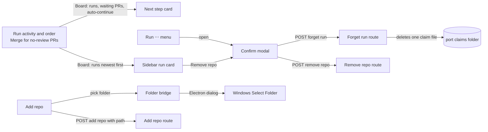
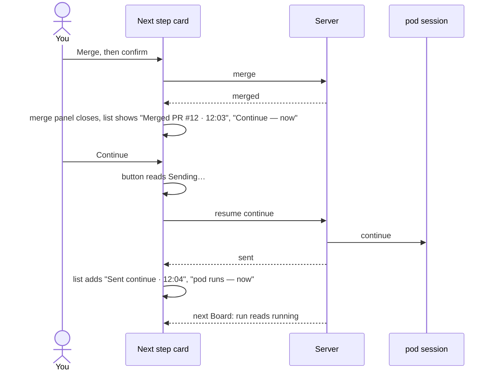

# Plan: UI rework (small, before v0.1.0)

_Generated: 2026-11-12 · Status: active · Grilled-with: pod (fast)_

Port base: 3000

## Goal
Make the run screen say what just happened and what comes next, so that Merge, then Continue, then pod running reads as one flow. Fix the defects seen during the windows-app install test. Replace the board's own folder browser with the Windows folder dialog. Let a leftover run be removed from the app.

## Why
On 2026-11-05 the human said "This UI is so bad, we need to rework on this" ([idea](../ideas/ui-rework.md)). The human holds `v0.1.0` until there is more done. These are the defects a first user hits on the main path.

Success: after a merge, the card names the next step at once. A Continue press shows a result before the next Board read. No run stays in the sidebar for good. Adding a repo uses the Windows dialog.

Constraints: current tokens, fonts, and `DESIGN.md`; no new palette. Windows first. The full run-screen redesign waits for the terminal host, which adds a Terminal tab and changes Continue.

## Scope
**In scope:**
- The Next step card after a merge: the merge panel closes, and the card shows a short list of what happened on this stop, then Continue.
- Continue feedback: "Sending…", then the sent line in that list, until the run state changes. No toast.
- Queue item 149: a `--no-review` task or fix PR gets Merge once its engineer has ended and no reviewer started.
- An `auto` tag on a sidebar run card when Auto-continue is on.
- The runs list sorted newest activity first.
- One shared modal component, used by Remove repo (with the folder path) and by a new **Forget this run** item in the run's ⋯ menu.
- Add repo: the Windows "Select Folder" dialog in the desktop app; a plain path field in the browser build. The board's folder browser and its folder-listing route are deleted.

**Out of scope:**
- A Delete or Clean up item that removes a leftover run's worktree and branch (the board would write to git; a separate decision).
- The full run-screen redesign, with the terminal host's Terminal tab.
- Other known issues about how runs read state (dead engineer, resume past gate, archived-plan questions, real stops with no toast).
- Linux and macOS folder dialogs (Electron provides them, but they are not tested in this plan).

## How it fits together

**Parts:**

| Part | New or changed | Where (existing folder or module) | Does |
|------|----------------|-----------------------------------|------|
| Run activity and order | changed | `packages/model` (runs) | Gives each run a last-activity time; sorts the runs list newest first |
| Merge for no-review PRs | changed | `packages/model` (fix runs, waiting PRs) | Puts a `--no-review` PR in the waiting PRs once its engineer ended with no reviewer |
| Forget run route | new | `packages/server` (action routes, action log) | Deletes one run's port claim file after the Board check; logs it |
| Folder route | removed | `packages/server` (folder list) | The folder-listing route goes away |
| Next step card | changed | `packages/web` screens/runs (next step, merge flow, resume flow) | Shows the "what happened" list on this stop; closes the merge panel on `merged`; shows Sending… and the sent line |
| Sidebar run card | changed | `packages/web` screens/runs (runs list) | Shows the `auto` tag and the newest-first order |
| Confirm modal | new | `packages/web` (shared component) | Centred modal with focus trap, Escape, and click-outside; used by Remove repo and Forget |
| Run ⋯ menu | changed | `packages/web` screens/runs (run menu) | Adds Forget this run |
| Add repo | changed | `packages/web` screens/runs (add dialog) | Calls the desktop bridge for a folder, or shows a path field in the browser build; deletes the folder browser |
| Folder bridge | new | `packages/desktop` (window, new preload) | Exposes one call, pick a folder, that opens Electron's folder dialog and returns a path or nothing |

**How they connect:**

**Main flow:** you merge a PR, then press Continue.

**Data:** no new stored data. The "what happened" list lives in the card's state for the current stop, and is built from the merge and resume results the card already receives. A run's last activity is computed when the Board is built, from the newest of: agent transcript writes, queue entry changes, and PR events (opened or merged). Forget deletes one file in the port claims folder and appends one `forget-run` line to `actions.jsonl`.

## Sprint sequence

| Sprint | Goal | Status | Depends on |
|--------|------|--------|------------|
| ui-rework | Ship every in-scope item above | active | — |

## Look
Same look as the app: [calm-dashboard Look](calm-dashboard.md#look), `packages/web/src/theme/tokens.css`, and `DESIGN.md`. The human picked each change from drawn options:

- **Thesis:** each card does one job and says what just happened, in the app's existing calm look.
- **Palette:** unchanged tokens. Dark: `--bg #000000`, `--surface #0a0a0a`, `--fg #ededed`, `--muted #a1a1a1`, `--primary-bg #ededed`, `--needs-you #f5a623`, `--running #52a8ff`, `--ready #3ecf72`, `--danger #ff5f5f`. Light values as in `tokens.css`.
- **Type:** Geist and Geist Mono, self-hosted, as today.
- **Layout:** the Next step card keeps its place. Under its title, a short vertical list (a thin left rule, one dot per item) shows what happened on this stop: done items with a green ring and a time, the current item filled in the needs-you colour. At phone width it stacks as today.
- **Signature detail:** the "what happened" list on the Next step card (choice 3 c).
- **Picks:** 1 b (the merge panel closes, and the card moves on), 2 b (the result shows in place, with no toast), 3 c (the "what happened" list), 4 b (the `auto` tag after the state), 5 b (newest first), 6 c (a modal with the folder path), 7 b (Forget asks in the same modal; the human chose Forget only), 8 b (the native dialog, plus a path field in the browser build).
- **Rules out:** new colours or fonts, toasts for your own clicks, inline confirms in the sidebar, icon-only signs.
- **Draft:** `pod-docs/design-drafts/ui-rework-choices.html` (picks above).

## Key decisions
- The merge panel closes on `merged`. The card shows the result as a list item, so `merged` + `Merged` and the double `PR #N` go away (human, 1 b).
- Continue shows "Sending…", then a sent item in the list. There is no toast for your own click (human, 2 b).
- The "what happened" list covers only the current stop. It resets when the run reaches a new stop (default).
- 149: Merge shows on a `--no-review` PR when the PR is open, its engineer has ended, and no reviewer started (default, Q6). Before the build, the sprint finds how the Board tells that a run is `--no-review`.
- Last activity is the newest of the agent transcript writes, the queue entry changes, and the PR events. The list keeps its order while nothing changes (default, Q11). The urgent banner still raises blocked runs from any page.
- The `auto` tag sits after the status, following the `DESIGN.md` rule for attributes (human, 4 b).
- Remove repo and Forget share one modal component. Remove repo shows the path, because two repos can share a name (human, 6 c).
- Forget deletes only the run's port claim file. The worktree and the branch stay, and the modal names the worktree path. The human chose Forget over Delete (7 a). Delete would be the board's first git write in a repo, against [the board writes only the queue file](../feature-details/actions.md#why-its-this-way), and worktree removal fails often on Windows ([known issue](../known-issues/worktree-folder-locked-on-windows.md)).
- Forget goes through the action guard and a Board check, as Merge and Remove do. The run must be on the Board, and the claim file must be in the port claims folder. It is logged as `forget-run`.
- Add repo uses Electron's folder dialog through a new preload with one call. This reverses the parked [native-folder-dialog](../ideas/native-folder-dialog.md) reasons, which applied to a dialog opened by a local server, not by Electron. The browser build gets a plain path field. The folder browser and `GET /api/fs/folders` are deleted, which also closes queue item 45 (the 1000-folder cap) (human, 8 b).
- The full run-screen redesign waits for the terminal host. This plan changes only what the defects need (agreed 2026-11-12).
- No web research. The defects are known, and the modal pattern is standard (default, Q1).

## Known risks
- The preload is the window's first bridge to the main process: expose only `pickFolder()`, check the sender's origin in the IPC handler, and keep `contextIsolation`, `sandbox`, and `nodeIntegration: false`.
- The native dialog can open behind the window: give it the app window as parent.
- The no-review rule may need a field pod doesn't write. If the Board can't tell, the sprint raises it in the queue before it guesses.
- Last-activity times read more files on each Board build: reuse the stat data the Board already reads, and add no new transcript reads.
- The sort moves cards while you look: keep the order stable between Board changes, and keep the selected run selected.

## Open questions
- None blocking. How the Board detects `--no-review` is a fact for the sprint to find (see risks).

## Verification
- After a merge on the mock or fixture repo, the merge panel closes. The Next step card shows "Merged PR #N · time" and Continue, and no text names the PR twice.
- A Continue press shows "Sending…" at once, then a sent item, before the run reads `running`. No toast is sent.
- A `--no-review` PR with an ended engineer and no reviewer shows Merge. The same PR while the engineer runs does not.
- A run with Auto-continue on shows the `auto` tag in the sidebar.
- The runs list puts the run with the newest activity on top, and the order does not change when nothing changes.
- Remove repo and Forget open the same centred modal. Escape and a click outside close it, and focus stays inside it. Remove repo shows the path.
- Forget removes a leftover run from the sidebar, the tray dot, and the banner. It deletes only that claim file, and the action log has a `forget-run` line.
- In the installed desktop app, Add repo opens the Windows "Select Folder" dialog, and the chosen folder is added. The browser build adds a repo from a typed path. `GET /api/fs/folders` returns 404.
- `pnpm verify` passes. The installed-app check covers Add repo, Merge → Continue, and Forget.
