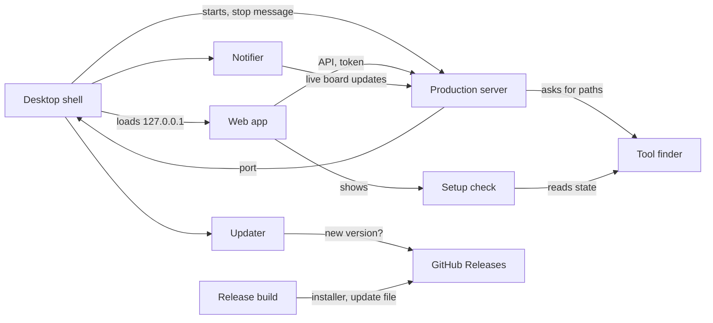
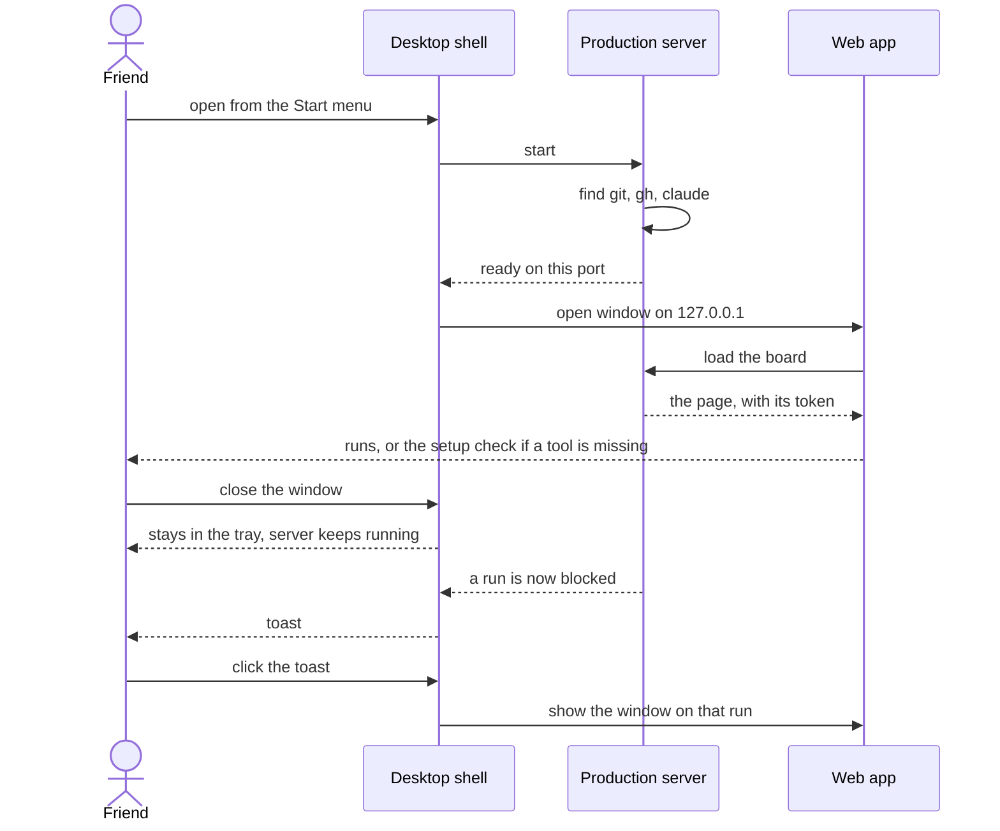

# Plan: Windows app

_Generated: 2026-11-02 · Status: active · Grilled-with: pod (fast)_

Port base: 3100

## Goal
Pod Board installs on Windows as a normal desktop app: a friend runs one installer, opens the app from the Start menu, and sees their pod runs. The app has its own window and tray icon, sends a toast when a run needs them, and updates itself from GitHub Releases.

## Why
The board runs only with `pnpm dev` on two ports, from a checkout, so nobody else can use it. The human's order is friends first, then public; Windows first, then Linux, then Mac.

**Success criteria:**
- A friend with `git`, `gh`, `claude`, and pod installed goes from the installer to their runs without a terminal.
- A friend with one of those missing sees what's missing and how to fix it, not an empty board.
- Quitting the app never stops a resumed `claude` run.
- A new tagged release reaches an installed app without a manual download.

**Constraints:** the backend stays Node, with no rewrite. `pnpm dev` keeps working as it does today. No mobile or accessibility work. Evidence: [research report](../research/windows-desktop-app.md).

## Scope
**In scope:**
- One production server that serves the built web app and the API on one port, started by one command (`pnpm start`).
- Finding `git`, `gh`, and `claude` when the app doesn't start from a terminal, with a setup check screen.
- An Electron shell: window, tray, close to tray, toasts, single instance, start at login.
- A per-user NSIS installer, built by GitHub Actions on a version tag, with auto-update from GitHub Releases.
- An MIT `LICENSE`, and a short install note for friends.

**Out of scope:**
- Code signing and a public launch. They are the next plan, and they must come before anyone outside the friends group installs it.
- Linux and Mac builds. Each is its own plan after Windows ships; this plan only avoids blocking them.
- The Microsoft Store, MSIX, and the Tauri shell.
- Master plan phases 3 and 4.

## How it fits together

**Parts:**

| Part | New or changed | Where (existing folder or module) | Does |
|------|----------------|-----------------------------------|------|
| Production server | changed | `packages/server` | Serves the web build and the API on one port; puts the token in the page itself; is bundled to one file |
| Tool finder | new | `packages/server` | Finds `git`, `gh`, and `claude` at start: the inherited `PATH`, the registry `Path`, known folders, then a path set in settings |
| Setup check | new | `packages/server`, `packages/web/src/screens` | Reports each tool's state; shows what's missing, with a recheck |
| Clean stop | changed | `packages/server` | Stops on a message or when its parent dies, waits for running actions, and leaves detached `claude` runs alone |
| Desktop shell | new | `packages/desktop` | Electron main process: starts the server, opens the window, owns the tray and quit |
| Notifier | new | `packages/desktop` | Reads the board's live updates and sends a toast for each new item that needs the human |
| Updater | new | `packages/desktop` | Checks GitHub Releases, downloads in the background, and asks before it restarts |
| Release build | new | `.github/workflows`, `packages/desktop` | On a version tag, builds the installer, launches it as a check, and publishes the release |

**How they connect:**
- Desktop shell → Production server: starts it with `utilityProcess` and gets the port back
- Desktop shell → Production server: sends the stop message on Quit
- Production server → Tool finder: asks for the tool paths at start
- Setup check → Tool finder: reads each tool's state
- Notifier → Production server: subscribes to live board updates
- Updater → GitHub Releases: checks for a new version
- Release build → GitHub Releases: publishes the installer and its update file

**Main flow:** a friend installs the app, and a run needs them.

**Data:** nothing new moves to a database.
- The app uses the existing config folder, so `config.json`, the action log, and the auto-continue toggles carry over from `pnpm dev`.
- New in that folder: the tool paths set in settings, and a small owner file (see Key decisions).
- The session token stays in server memory in production.
- Electron keeps its own window state in its own app-data folder.

## Sprint sequence

| Sprint | Goal | Status | Depends on |
|--------|------|--------|------------|
| one-port-server | `pnpm start` runs the bundled server and web app on one port, with the `LICENSE` added | planned | — |
| outside-terminal | The server works with no terminal: tool finder, setup check, clean stop | planned | one-port-server |
| desktop-shell | Electron window, tray, toasts, single instance, start at login | planned | outside-terminal |
| installer-and-updates | NSIS installer, release workflow, auto-update, install note | planned | desktop-shell |

Start `one-port-server` after PR #72 merges, because both change the server's start code.

## Look
No new look. The human left this choice to the agent, which picked the existing design and no new directions, because this plan adds one small screen to an app whose look is settled.
- **Thesis, palette, type, and layout:** as in `DESIGN.md` and `packages/web/src/theme/tokens.css`. No new tokens.
- **Setup check screen:** one row per tool, using the board's existing dot plus word for its state, then what to do, with one Recheck button and a path field for a tool that wasn't found.
- **Window:** the normal Windows title bar. No custom frame.
- **Tray:** the app icon, with a dot when something needs the human. Menu: Open, Start at login, Quit.
- **Rules out:** a splash screen, a custom title bar, and a first-run tour.
- **Draft:** none; the human sees the screen in the plan's preview.

## Key decisions
- **Electron, not Tauri.** The human's choice, from the [research](../research/windows-desktop-app.md): Electron includes Node, while Tauri adds Rust and a separately built server. This reverses the parked idea and `app-shell.md`'s "not Tauri or Electron". See `pod-docs/decisions.md`.
- **Friends first, public later.** The human's choice. This reverses "one user on one machine" in the 2026-10-21 decision.
- **MIT licence.** The human's choice.
- **A friend's build is unsigned.** Friends click through SmartScreen, and the install note says so. Signing comes before a public launch. (default)
- **Auto-update with the signature check off.** Friends won't rebuild, so `electron-updater` runs with `verifyUpdateCodeSignature: false`, as an unsigned build needs. Nothing then proves who published an update, so the GitHub account is the trust boundary. The human keeps 2FA on. Signing turns the check back on. (default)
- **Quit never kills a resumed run.** The research suggests a process-tree kill or a Job Object, but both would stop the detached `claude` runs that the board starts on purpose (`claude-runner.ts`). Quit sends the server a stop message, and the server waits for its actions through its existing shutdown. Only after a timeout does the shell kill the server's own process. No tree kill and no Job Object. `gh` children are short-lived, so they end on their own. (default)
- **The server stops by message, not by signal,** because a kill on Windows is abrupt. It also watches its parent process and runs the same stop when the parent dies, because Electron's quit events don't fire on shutdown or after a crash. (default)
- **Server in `utilityProcess`,** not in the main process, so a server crash doesn't take the window down. The shell restarts it once and shows the error if it fails again. (default)
- **The bundled server is copied in through `extraResources`, not `node_modules`,** which avoids the pnpm packaging bugs in the research. `packages/desktop` bundles its own main process too. (default)
- **A fixed port with a fallback.** The app prefers one fixed port outside pod's claim ranges (47800), because the web app's saved state belongs to the origin and would be lost on a port change. If that port is busy, it takes a free one for that launch. The Host check uses the real port. (default)
- **In production, the token lives in memory** and goes into `index.html` per request, with no caching. Writing the token file would break a `pnpm dev` page open on the same config folder. Dev keeps the file and the Vite plugin. (default)
- **One auto-continue owner per config folder.** The app and `pnpm dev` share a config folder, and two servers could each send `continue` to one run. The first server takes an owner file (with a stale check on its process ID). A second server still runs but does not auto-continue, and logs why. (default)
- **Missing web files answer 404.** The production fallback serves `index.html` only for page routes, not for `/api` or a missing file. This avoids the known `/sw.js` answering 200 with HTML. (default)
- **Toasts cover blocked, merge, and reply items only,** once per item, and a click opens that run. `pending` queue items don't toast, because they aren't urgent enough to interrupt. (default)
- **Close hides to the tray.** Runs and auto-continue need the server alive. Quit is in the tray menu. Start at login is off until the human turns it on. (default)
- **The tool finder merges the registry `Path`** with the inherited one, then checks known folders, and a path in settings wins. `.cmd` handling stays in the existing `bin-path.ts` and `claude-runner.ts`. (default)
- **The human starts each release** by pushing a version tag. Agents build the workflow but never publish a release. (default)
- **`pnpm dev` stays as it is:** two ports, the token file, and watch mode. (default)
- **Open queue item taken into this plan:** resumed runs drop all `CLAUDE*` variables (2026-10-23), which could stop `claude` on a friend's machine that sets one only in its shell. The setup check's install note says these belong in `settings.json` `env`. (default)

## Known risks
- **`electron-updater`'s GitHub setup is unverified:** its docs returned 404 during research, and the signature rule comes from its master branch. Mitigation: `installer-and-updates` publishes two throwaway versions to a test release and proves one updates to the other.
- **A stale `PATH` on a Start-menu launch is an inference, not a sourced fact.** Mitigation: `outside-terminal` tests with a stripped environment, and the tool finder doesn't depend on the inherited `PATH`.
- **`utilityProcess` exit behavior on Windows is undocumented.** Mitigation: `desktop-shell` tests a normal quit, a killed main process, and a killed server on this machine, and checks that no server is left running.
- **A packaged build can exit 0 and still be broken.** Mitigation: the release workflow launches the installed app and checks the installer size.
- **Smart App Control can block an unsigned app outright.** Mitigation: the install note says so. If it blocks a friend, signing moves up.
- **Other bundling faults:** a bundled CommonJS dependency can fail under ESM with "Dynamic require". Mitigation: `one-port-server` runs the bundle by itself, outside the repo, with no `node_modules`.
- **Other apps' experience, not this one's:** no source tested Hono, chokidar, or the `claude` CLI in a packaged app. Each sprint checks the real thing on this machine.
- **A bad auto-update reaches every friend.** Mitigation: the human tags each release; the check above runs before publish.

## Open questions
- None block the plan. Signing and the public launch wait for the next plan: Artifact Signing is limited to the US and Canada for individuals, so an OV certificate may be the route.

## Verification
- **One port:** with `pnpm build` then `pnpm start`, one port serves the page and the API. A hard reload on a client route works, `/sw.js` answers 404, and an action works with the page's token and fails without it.
- **Bundle:** the bundled server runs from a folder outside the repo with no `node_modules`.
- **Dev unchanged:** `pnpm dev` still runs on two ports and `pnpm verify` passes.
- **No terminal:** the server, started with a stripped `Path`, still finds `git`, `gh`, and `claude`; `gh` calls work; no console window appears.
- **Setup check:** with `claude` hidden, the screen names it and how to fix it; Recheck clears it once it's back; a path set in settings is used.
- **Clean quit:** with a resumed `claude` run going, Quit leaves that run alive and leaves no server process. Killing the main process also ends the server, within seconds, and leaves the run alive.
- **One auto-continue owner:** with two servers on one config folder, only one sends `continue`.
- **Shell:** closing the window keeps the tray and the server; a second launch focuses the first window; toggling Start at login changes the login item.
- **Toast:** an installed build sends a toast with the app's name when a run becomes blocked, once, and a click opens that run.
- **Installer:** a per-user install needs no admin rights, the Start-menu entry opens the app, and uninstalling removes the app but keeps the config folder.
- **Release:** a version tag produces a release with the installer; the workflow fails if the installed app doesn't start.
- **Update:** an installed older test version finds, downloads, and installs a newer one, after asking.
- **Licence and note:** `LICENSE` holds the MIT text, and the install note covers SmartScreen, Smart App Control, and the tools a friend needs.
